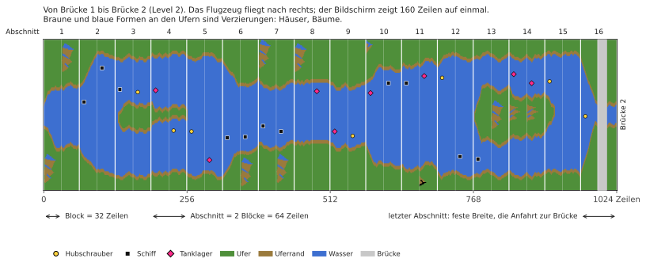

# River Raid (Atari 8-bit) → C++

[English](README.md) | [Русский](README.ru.md) | [Українська](README.uk.md) | Deutsch | [Polski](README.pl.md) | [Italiano](README.it.md) | [Español](README.es.md) | [中文](README.zh.md) | [日本語](README.ja.md)

Reverse Engineering und C++-Portierung von Activisions River Raid für Atari 400/800 (1983) mit dem
Ziel, Spiellogik und Sound 1:1 auf heutigen Windows-, Linux- und macOS-Rechnern wiederzugeben.

**[Wie River Raid funktioniert](docs/HOW_IT_WORKS.de.md)**: eine bebilderte Erklärung für alle, ohne
Programmierkenntnisse: wie der endlose Fluss entsteht, warum er in jedem Spiel gleich ist, wie
Gegner und Brücken platziert werden, warum es schwerer wird und wie ein einziges Sprite jeden
Gegner auf dem Bildschirm zeigt.

- [`HANDOFF.de.md`](HANDOFF.de.md) — Projektstand, geprüfte Fakten, Entscheidungen, nächste Schritte (hier anfangen)
- [`docs/HOW_IT_WORKS.de.md`](docs/HOW_IT_WORKS.de.md) — wie das Spiel funktioniert, für alle: Fluss, Gegner, Brücken, Kollisionen
- [`docs/NOTES.de.md`](docs/NOTES.de.md) — Erkenntnisse mit Adressen
- `disasm/` — kommentiertes Disassembly
- `tools/` — Disassembler, Prüfskripte
- `oracle/` — Referenzlauf auf libatari800 (RAM- und POKEY-Traces Bild für Bild)
- [`port/`](port/README.de.md) — die C++-Portierung: das Spiel (`river_raid`), der Fluss-Betrachter, Prüfwerkzeuge
- `rom/` — hier Ihr eigenes ROM-Abbild ablegen (nicht enthalten)

## Hinweis
Dies ist ein inoffizielles Fanprojekt zu Lernzwecken: Es soll zeigen, wie ein Spiel von 1983 funktioniert, wie sein Code den Fluss, die Gegner und den Sound erzeugt, und das in lesbarem C++ darstellen. Es steht in keiner Verbindung zu Activision oder Microsoft und wird von ihnen weder unterstützt noch gefördert. River Raid und Activision sind Marken ihrer Inhaber; sie werden hier nur genannt, um zu sagen, um welches Spiel es geht.

Kein Teil des Spiels ist enthalten: kein ROM, keine Grafik, kein Sound. Um die Portierung zu starten, brauchen Sie Ihr eigenes Abbild des River-Raid-Moduls (8 KB, siehe `rom/README.md`). Bitte fragen Sie nicht in Issues, wo man es bekommt.
