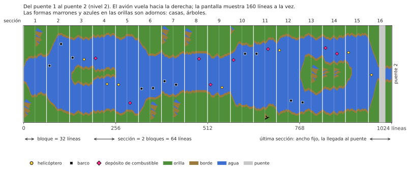

# River Raid (Atari 8-bit) → C++

[English](README.md) | [Русский](README.ru.md) | [Українська](README.uk.md) | [Deutsch](README.de.md) | [Polski](README.pl.md) | [Italiano](README.it.md) | Español | [中文](README.zh.md) | [日本語](README.ja.md)

Ingeniería inversa y port a C++ de River Raid de Activision para Atari 400/800 (1983), con el
objetivo de reproducir la lógica del juego y el sonido 1:1 en Windows, Linux y macOS actuales.

**[Cómo funciona River Raid](docs/HOW_IT_WORKS.es.md)**: una explicación ilustrada para todos, sin
programación: cómo se crea el río sin fin, por qué es igual en cada partida, cómo se colocan
enemigos y puentes, por qué se vuelve más difícil y cómo un solo sprite muestra a todos los
enemigos de la pantalla.

- [`HANDOFF.es.md`](HANDOFF.es.md) — estado del proyecto, hechos verificados, decisiones, próximos pasos (empezar aquí)
- [`docs/HOW_IT_WORKS.es.md`](docs/HOW_IT_WORKS.es.md) — cómo funciona el juego, para todos: río, enemigos, puentes, colisiones
- [`docs/NOTES.es.md`](docs/NOTES.es.md) — hallazgos con direcciones
- `disasm/` — desensamblado comentado
- `tools/` — desensamblador, scripts de verificación
- `oracle/` — ejecución de referencia sobre libatari800 (trazas de RAM y POKEY fotograma a fotograma)
- [`port/`](port/README.es.md) — el port a C++: el juego (`river_raid`), el visor del río, herramientas de comparación
- `rom/` — ponga aquí su propio volcado de la ROM (no incluido)

## Aviso
Este es un proyecto no oficial de aficionados, hecho con fines educativos: entender cómo funciona un juego de 1983, cómo su código crea el río, los enemigos y el sonido, y mostrarlo en un C++ legible. No está afiliado, respaldado ni patrocinado por Activision ni Microsoft. River Raid y Activision son marcas de sus propietarios; aquí se usan solo para decir de qué juego se trata.

No se incluye ninguna parte del juego: ni ROM, ni gráficos, ni sonido. Para ejecutar el port necesita su propio volcado del cartucho de River Raid (8 KB, vea `rom/README.md`). Por favor, no abra issues preguntando dónde conseguirlo.
