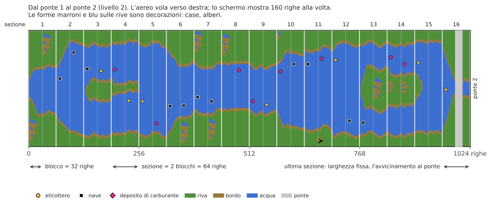

# River Raid (Atari 8-bit) → C++

[English](README.md) | [Русский](README.ru.md) | [Українська](README.uk.md) | [Deutsch](README.de.md) | [Polski](README.pl.md) | Italiano | [Español](README.es.md) | [中文](README.zh.md) | [日本語](README.ja.md)

Reverse engineering e port in C++ di River Raid di Activision per Atari 400/800 (1983), con
l'obiettivo di riprodurre logica di gioco e suono 1:1 su Windows, Linux e macOS di oggi.

**[Come funziona River Raid](docs/HOW_IT_WORKS.it.md)**: una spiegazione illustrata per tutti, senza
programmazione: come nasce il fiume senza fine, perché è uguale in ogni partita, come vengono
piazzati nemici e ponti, perché diventa più difficile e come un solo sprite mostra tutti i
nemici sullo schermo.

- [`HANDOFF.it.md`](HANDOFF.it.md) — stato del progetto, fatti verificati, decisioni, prossimi passi (iniziare da qui)
- [`docs/HOW_IT_WORKS.it.md`](docs/HOW_IT_WORKS.it.md) — come funziona il gioco, per tutti: fiume, nemici, ponti, collisioni
- [`docs/NOTES.it.md`](docs/NOTES.it.md) — scoperte con indirizzi
- `disasm/` — disassemblato annotato
- `tools/` — disassemblatore, script di verifica
- `oracle/` — esecuzione di riferimento su libatari800 (tracce di RAM e POKEY fotogramma per fotogramma)
- [`port/`](port/README.it.md) — il port in C++: il gioco (`river_raid`), il visualizzatore del fiume, gli strumenti di confronto
- `rom/` — mettete qui il vostro dump della ROM (non incluso)

## Avvertenza
Questo è un progetto amatoriale non ufficiale, realizzato a scopo didattico: capire come funziona un gioco del 1983, come il suo codice crea il fiume, i nemici e il suono, e mostrarlo in un C++ leggibile. Non è affiliato, approvato né sponsorizzato da Activision o Microsoft. River Raid e Activision sono marchi dei rispettivi proprietari; sono usati qui solo per dire di quale gioco si tratta.

Nessuna parte del gioco è inclusa: niente ROM, niente grafica, niente suono. Per avviare il port serve il proprio dump della cartuccia di River Raid (8 KB, vedi `rom/README.md`). Per favore non aprite issue per chiedere dove trovarlo.
