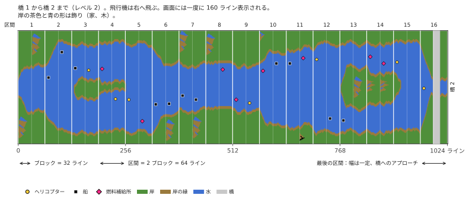

# River Raid (Atari 8-bit) → C++

[English](README.md) | [Русский](README.ru.md) | [Українська](README.uk.md) | [Deutsch](README.de.md) | [Polski](README.pl.md) | [Italiano](README.it.md) | [Español](README.es.md) | [中文](README.zh.md) | 日本語

Activision の Atari 400/800 版 River Raid（1983）のリバースエンジニアリングと C++ への移植です。目標は、今の Windows、Linux、macOS でゲームのロジックとサウンドを 1:1 で再現することです。

**[River Raid のしくみ](docs/HOW_IT_WORKS.ja.md)**：プログラミングの知識がなくても読める、図入りの解説です。終わりのない川がどう作られるか、なぜどのゲームでも同じなのか、敵と橋がどう配置されるか、なぜだんだん難しくなるのか、そして 1 つのスプライトが画面のすべての敵をどう表示するのか。

- [`HANDOFF.ja.md`](HANDOFF.ja.md) — プロジェクトの状態、検証済みの事実、決定事項、次の作業（ここから読む）
- [`docs/HOW_IT_WORKS.ja.md`](docs/HOW_IT_WORKS.ja.md) — ゲームのしくみ、誰でも読める解説：川、敵、橋、衝突
- [`docs/NOTES.ja.md`](docs/NOTES.ja.md) — アドレス付きの調査結果
- `disasm/` — 注釈付きの逆アセンブル
- `tools/` — 逆アセンブラ、検証スクリプト
- `oracle/` — libatari800 による基準実行（フレームごとの RAM と POKEY の記録）
- [`port/`](port/README.ja.md) — C++ 移植：ゲーム（`river_raid`）、川のビューア、照合ツール
- `rom/` — ここに自分の ROM ダンプを置く（リポジトリには含まれない）

## 免責事項
これは非公式のファンプロジェクトで、教育目的で作られました。1983 年のゲームがどう動くのか、そのコードが川や敵や音をどう作るのかを調べ、読みやすい C++ で示すためのものです。Activision や Microsoft とは無関係で、承認や支援も受けていません。River Raid と Activision はそれぞれの所有者の商標であり、ここではどのゲームの話かを示すためだけに使っています。

ゲームのいかなる部分も含まれていません。ROM も、グラフィックも、サウンドもありません。移植版を動かすには、River Raid のカートリッジを自分でダンプしたもの（8 KB、[`rom/README.ja.md`](rom/README.ja.md) を参照）が必要です。入手先を issues で尋ねないでください。
