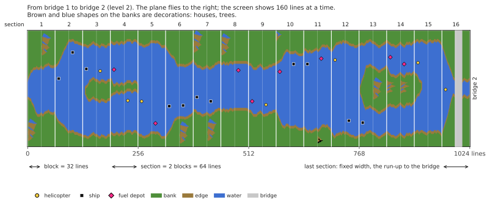

# River Raid (Atari 8-bit) → C++

English | [Русский](README.ru.md) | [Українська](README.uk.md) | [Deutsch](README.de.md) | [Polski](README.pl.md) | [Italiano](README.it.md) | [Español](README.es.md) | [中文](README.zh.md) | [日本語](README.ja.md)

Reverse engineering and C++ port of Activision's River Raid for Atari 400/800 (1983),
aiming for 1:1 game logic and 1:1 sound on modern Windows, Linux and macOS.

**[How River Raid works](docs/HOW_IT_WORKS.md)**: an illustrated explanation for everyone, no
programming needed: how the endless river is made, why it is the same in every game, how enemies
and bridges are placed, why it gets harder, and how one sprite shows every enemy on the screen.

- [`HANDOFF.md`](HANDOFF.md) — project state, verified facts, decisions, next steps (start here)
- [`docs/HOW_IT_WORKS.md`](docs/HOW_IT_WORKS.md) — how the game works, for everyone: the river, enemies, bridges, collisions
- [`docs/NOTES.md`](docs/NOTES.md) — findings with addresses
- `disasm/` — annotated disassembly
- `tools/` — disassembler, verification scripts
- `oracle/` — reference runner on libatari800 (frame-by-frame RAM / POKEY traces)
- [`port/`](port/README.md) — C++ port: the game (`river_raid`), the river viewer, check tools
- `rom/` — put your own ROM dump here (not included)

## Disclaimer
This is an unofficial fan project, made for educational purposes: to study how a 1983 game works, how its code makes the river, the enemies and the sound, and to show it in readable C++. It is not affiliated with, endorsed or sponsored by Activision or Microsoft. River Raid and Activision are trademarks of their owners; they are used here only to say which game this is about.

No part of the game is included: no ROM, no graphics, no sound. To run the port you need your own dump of the River Raid cartridge (8 KB, see [`rom/README.md`](rom/README.md)). Please do not open issues asking where to get one.

## License
The project's own code and documentation are under the MIT license, see [`LICENSE`](LICENSE). Exceptions:
- `port/src/os_font.cpp` contains the character set of AltirraOS (Copyright © 2008–2018 Avery Lee), which comes with its own all-permissive license; the notice is kept in that file.
- `oracle/rr_oracle` is linked with libatari800 and is therefore under GPL-2.0+ (see [`oracle/README.md`](oracle/README.md)). The port does not link with it.
- The two palette models in `port/src/palette.cpp` follow the colour models of the emulators Altirra and atari800; the code is written anew.
- River Raid itself (the ROM, its code, graphics and sound) belongs to its right holders and is not covered by this license.
