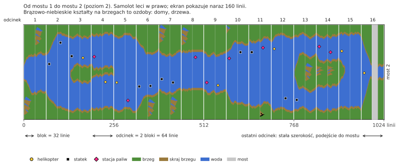

# River Raid (Atari 8-bit) → C++

[English](README.md) | [Русский](README.ru.md) | [Українська](README.uk.md) | [Deutsch](README.de.md) | Polski | [Italiano](README.it.md) | [Español](README.es.md) | [中文](README.zh.md) | [日本語](README.ja.md)

Inżynieria wsteczna i port na C++ gry River Raid firmy Activision dla Atari 400/800 (1983). Cel:
logika gry 1:1 i dźwięk 1:1 na współczesnych Windows, Linux i macOS.

**[Jak działa River Raid](docs/HOW_IT_WORKS.pl.md)**: ilustrowane wyjaśnienie dla każdego, bez
programowania: jak powstaje nieskończona rzeka, dlaczego jest taka sama w każdej grze, jak
rozmieszczani są wrogowie i mosty, dlaczego robi się trudniej i jak jeden sprite pokazuje
wszystkich wrogów na ekranie.

- [`HANDOFF.pl.md`](HANDOFF.pl.md) — stan projektu, sprawdzone fakty, decyzje, następne kroki (zacznij tutaj)
- [`docs/HOW_IT_WORKS.pl.md`](docs/HOW_IT_WORKS.pl.md) — jak działa gra, dla każdego: rzeka, wrogowie, mosty, kolizje
- [`docs/NOTES.pl.md`](docs/NOTES.pl.md) — odkrycia z adresami
- `disasm/` — opisany deasembler
- `tools/` — deasembler, skrypty sprawdzające
- `oracle/` — przebieg wzorcowy na libatari800 (ślady RAM i POKEY klatka po klatce)
- [`port/`](port/README.pl.md) — port na C++: gra (`river_raid`), przeglądarka rzeki, narzędzia porównawcze
- `rom/` — tu połóż własny zrzut ROM (nie jest dołączony)

## Zastrzeżenie
To nieoficjalny projekt fanowski, stworzony w celach edukacyjnych: by zrozumieć, jak działa gra z 1983 roku, jak jej kod tworzy rzekę, wrogów i dźwięk, i pokazać to w czytelnym C++. Nie jest powiązany z Activision ani Microsoft, ani przez nie popierany czy sponsorowany. River Raid i Activision są znakami towarowymi ich właścicieli; użyto ich tu tylko po to, by powiedzieć, o jaką grę chodzi.

Projekt nie zawiera żadnej części gry: ani ROM-u, ani grafiki, ani dźwięku. Aby uruchomić port, potrzebny jest własny zrzut kartridża River Raid (8 KB, zob. [`rom/README.pl.md`](rom/README.pl.md)). Prosimy nie pytać w issues, skąd go wziąć.

## Licencja
Własny kod i dokumentacja projektu są objęte licencją MIT, zob. [`LICENSE`](LICENSE). Wyjątki:
- `port/src/os_font.cpp` zawiera zestaw znaków AltirraOS (Copyright © 2008–2018 Avery Lee) na jego własnej swobodnej licencji (all-permissive); jej tekst jest zachowany w tym pliku.
- `oracle/rr_oracle` jest linkowany z libatari800, dlatego jest objęty GPL-2.0+ (zob. [`oracle/README.pl.md`](oracle/README.pl.md)). Port nie jest z nią linkowany.
- Dwa modele palety w `port/src/palette.cpp` odwzorowują modele kolorów emulatorów Altirra i atari800; kod napisano od nowa.
- Sama gra River Raid (ROM, jej kod, grafika i dźwięk) należy do właścicieli praw i nie jest objęta tą licencją.
