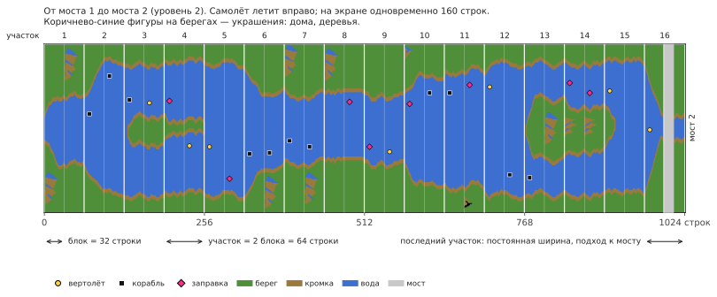

# River Raid (Atari 8-bit) → C++

[English](README.md) | Русский | [Українська](README.uk.md) | [Deutsch](README.de.md) | [Polski](README.pl.md) | [Italiano](README.it.md) | [Español](README.es.md) | [中文](README.zh.md) | [日本語](README.ja.md)

Реверс-инжиниринг и порт на C++ игры River Raid от Activision для Atari 400/800 (1983). Цель — логика 1 в 1 и звук 1 в 1 на современных Windows, Linux и macOS.

**[Как устроен River Raid](docs/HOW_IT_WORKS.ru.md)** — объяснение с картинками для всех, без
программирования: как получается бесконечная река, почему она одинаковая в каждой игре, как
расставляются враги и мосты, почему становится сложнее и как один спрайт показывает всех врагов
на экране.

- [`HANDOFF.ru.md`](HANDOFF.ru.md) — состояние проекта, проверенные факты, решения, следующие шаги (начинать отсюда)
- [`docs/HOW_IT_WORKS.ru.md`](docs/HOW_IT_WORKS.ru.md) — как устроена игра, для всех: река, враги, мосты, столкновения
- [`docs/NOTES.ru.md`](docs/NOTES.ru.md) — находки с адресами
- `disasm/` — размеченный листинг
- `tools/` — дизассемблер, скрипты проверки
- `oracle/` — эталонный прогон на libatari800 (покадровые трассы RAM и POKEY)
- [`port/`](port/README.ru.md) — C++ порт: игра (`river_raid`), просмотрщик реки, утилиты сверки
- `rom/` — сюда положите свой дамп ROM (в репозиторий не входит)

## Оговорка
Это неофициальный любительский проект, созданный в образовательных целях: разобраться, как устроена игра 1983 года, как её код строит реку, врагов и звук, и показать это на читаемом C++. Проект не связан с Activision и Microsoft и не одобрен ими. River Raid и Activision — товарные знаки их владельцев; здесь они используются только для того, чтобы сказать, о какой игре речь.

Никаких частей игры в проекте нет: ни ROM, ни графики, ни звука. Чтобы запустить порт, нужен свой дамп картриджа River Raid (8 КБ, см. `rom/README.md`). Пожалуйста, не спрашивайте в issues, где его взять.
