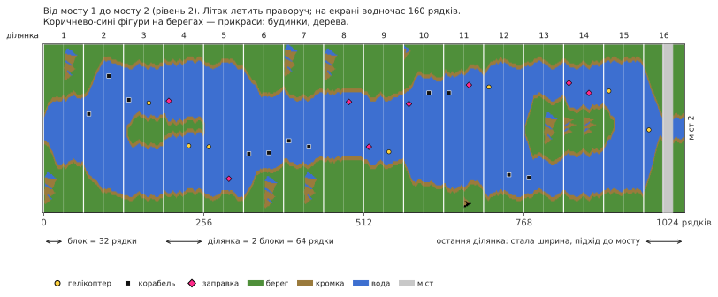

# River Raid (Atari 8-bit) → C++

[English](README.md) | [Русский](README.ru.md) | Українська | [Deutsch](README.de.md) | [Polski](README.pl.md) | [Italiano](README.it.md) | [Español](README.es.md) | [中文](README.zh.md) | [日本語](README.ja.md)

Реверс-інжиніринг і порт на C++ гри River Raid від Activision для Atari 400/800 (1983). Мета — логіка 1 в 1 і звук 1 в 1 на сучасних Windows, Linux і macOS.

**[Як влаштований River Raid](docs/HOW_IT_WORKS.uk.md)** — пояснення з картинками для всіх, без
програмування: як виходить нескінченна річка, чому вона однакова в кожній грі, як
розставляються вороги й мости, чому стає складніше і як один спрайт показує всіх ворогів
на екрані.

- [`HANDOFF.uk.md`](HANDOFF.uk.md) — стан проєкту, перевірені факти, рішення, наступні кроки (починати звідси)
- [`docs/HOW_IT_WORKS.uk.md`](docs/HOW_IT_WORKS.uk.md) — як влаштована гра, для всіх: річка, вороги, мости, зіткнення
- [`docs/NOTES.uk.md`](docs/NOTES.uk.md) — знахідки з адресами
- `disasm/` — розмічений лістинг
- `tools/` — дизасемблер, скрипти перевірки
- `oracle/` — еталонний прогін на libatari800 (покадрові траси RAM і POKEY)
- [`port/`](port/README.uk.md) — порт на C++: гра (`river_raid`), переглядач річки, утиліти звіряння
- `rom/` — сюди покладіть свій дамп ROM (до репозиторію не входить)

## Застереження
Це неофіційний аматорський проєкт, створений з освітньою метою: розібратися, як влаштована гра 1983 року, як її код будує річку, ворогів і звук, і показати це на читабельному C++. Проєкт не пов'язаний з Activision і Microsoft і не схвалений ними. River Raid і Activision — товарні знаки їхніх власників; тут вони вживаються лише для того, щоб сказати, про яку гру йдеться.

Жодних частин гри в проєкті немає: ні ROM, ні графіки, ні звуку. Щоб запустити порт, потрібен свій дамп картриджа River Raid (8 КБ, див. [`rom/README.uk.md`](rom/README.uk.md)). Будь ласка, не питайте в issues, де його взяти.

## Ліцензія
Власний код і документація проєкту поширюються за ліцензією MIT, див. [`LICENSE`](LICENSE). Винятки:
- `port/src/os_font.cpp` містить набір символів AltirraOS (Copyright © 2008–2018 Avery Lee) під його власною вільною ліцензією (all-permissive); її текст збережено в цьому файлі.
- `oracle/rr_oracle` збирається разом із libatari800 і тому поширюється за GPL-2.0+ (див. [`oracle/README.uk.md`](oracle/README.uk.md)). Порт із нею не пов'язаний.
- Дві моделі палітри в `port/src/palette.cpp` повторюють колірні моделі емуляторів Altirra та atari800; код написано заново.
- Сама River Raid (ROM, її код, графіка й звук) належить правовласникам, і ця ліцензія на неї не поширюється.
