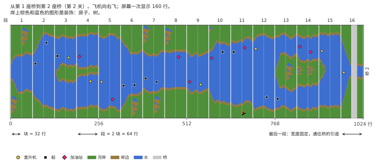

# River Raid (Atari 8-bit) → C++

[English](README.md) | [Русский](README.ru.md) | [Українська](README.uk.md) | [Deutsch](README.de.md) | [Polski](README.pl.md) | [Italiano](README.it.md) | [Español](README.es.md) | 中文 | [日本語](README.ja.md)

对 Activision 出品的 Atari 400/800 版 River Raid（1983）进行逆向工程并移植到 C++，目标是在现代的 Windows、Linux 和 macOS 上做到游戏逻辑 1:1、声音 1:1。

**[River Raid 是如何运作的](docs/HOW_IT_WORKS.zh.md)**：一篇图文说明，人人都能看懂，无需编程知识：无尽的河是怎么生成的，为什么每局都一样，敌人和桥是怎么摆放的，为什么越来越难，以及一个精灵如何显示屏幕上的所有敌人。

- [`HANDOFF.zh.md`](HANDOFF.zh.md) — 项目状态、已验证的事实、决定、下一步（从这里开始）
- [`docs/HOW_IT_WORKS.zh.md`](docs/HOW_IT_WORKS.zh.md) — 游戏如何运作，写给所有人：河、敌人、桥、碰撞
- [`docs/NOTES.zh.md`](docs/NOTES.zh.md) — 带地址的发现
- `disasm/` — 带注释的反汇编
- `tools/` — 反汇编器、校验脚本
- `oracle/` — 基于 libatari800 的参考运行（逐帧的 RAM 和 POKEY 记录）
- [`port/`](port/README.zh.md) — C++ 移植：游戏（`river_raid`）、河流查看器、比对工具
- `rom/` — 把你自己的 ROM 转储放在这里（不包含在仓库中）

## 声明
这是一个非官方的爱好者项目，出于学习目的而做：弄清一款 1983 年的游戏如何运作，它的代码如何生成河流、敌人和声音，并用易读的 C++ 展示出来。本项目与 Activision 和 Microsoft 无关，也未获得它们的认可或赞助。River Raid 和 Activision 是其所有者的商标，这里提到它们只是为了说明讲的是哪款游戏。

项目中不包含游戏的任何部分：没有 ROM，没有图形，没有声音。要运行移植版，你需要自己的 River Raid 卡带转储（8 KB，见 [`rom/README.zh.md`](rom/README.zh.md)）。请不要在 issues 里询问从哪里获取。
