# Wie River Raid funktioniert

[English](HOW_IT_WORKS.md) | [Русский](HOW_IT_WORKS.ru.md) | [Українська](HOW_IT_WORKS.uk.md) | Deutsch | [Polski](HOW_IT_WORKS.pl.md) | [Italiano](HOW_IT_WORKS.it.md) | [Español](HOW_IT_WORKS.es.md) | [中文](HOW_IT_WORKS.zh.md) | [日本語](HOW_IT_WORKS.ja.md)

Diese Erklärung ist für alle Neugierigen, Programmierkenntnisse sind nicht nötig: wie River Raid für
die 8-Bit-Ataris (Activision, 1983) seinen endlosen Fluss baut, Gegner und Brücken platziert und
herausfindet, was was getroffen hat. Alles hier wurde aus dem Originalprogramm gelesen und Bild für
Bild damit verglichen (siehe `port/README.de.md`). Zahlen stehen so, wie das Spiel sie verwendet; wo
es hilft, steht in Klammern der Name der passenden Funktion im Code der Portierung. Die Bilder
wurden mit dem Flussgenerator der Portierung in eigenen, schlichten Farben gezeichnet
(`tools/doc_figures.py`).

## Der Bildschirm

Das Spiel zeigt 60 Bilder pro Sekunde (auf einem amerikanischen NTSC-Gerät; genau 59,92). Der
Flussbereich ist 160 Zeilen hoch und 192 Punkte breit, und jeder Punkt hat eine von vier Farben:
Ufer (grün), der Rand zwischen Ufer und Wasser, Wasser (blau) und Schwarz, wo nichts gezeichnet ist.
Darunter liegt die Anzeige: Tankanzeige, Punkte, Leben, Brückenzähler und eine Laufschrift mit dem
Activision-Logo.

Das Flugzeug bleibt immer unten im Bild. Was sich bewegt, ist der Fluss: Immer wieder wird oben eine
neue Zeile gezeichnet, und alles andere rückt eine Zeile nach unten. Bei normaler Geschwindigkeit ist
das eine Zeile pro Bild, 60 Zeilen pro Sekunde; Knüppel nach vorn verdoppelt das, nach hinten
halbiert es (`scrollRiver`). Ein ganzer Fluss ist nirgends gespeichert: Jede Zeile existiert nur von
dem Moment an, in dem sie oben gezeichnet wird, bis sie unten aus dem Bild läuft.

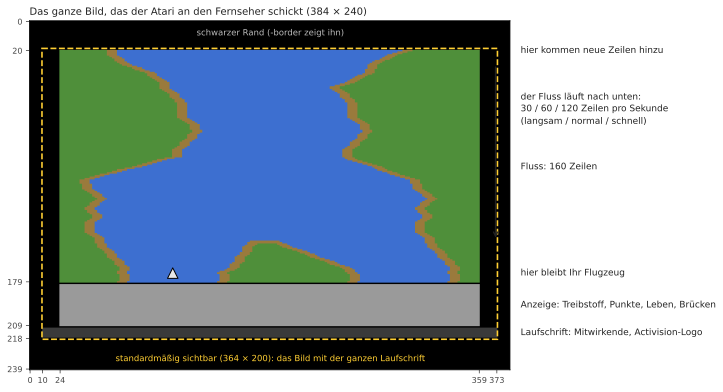

## Ein Fluss, der immer gleich ist

Der Fluss von River Raid sieht zufällig aus, ist aber seit 1983 in jedem Spiel und auf jedem Atari
identisch. Er stammt aus einem *Pseudozufallszahlengenerator*: einem 24-Bit-„Schieberegister“, das
pro Zeile nach einer festen Regel durchgemischt wird (`stepLfsr`). Vom selben Wert aus gestartet
liefert es immer dieselbe Zahlenfolge, also erscheinen dieselben Kurven, Inseln und Gegner an
denselben Stellen. Die Startpunkte der Spiele 1–8 (Brücke 1, 5, 20 oder 50) sind die Zustände dieses
Registers und die Uferposition an diesen Brücken desselben Flusses, gespeichert, damit das Spiel den
Fluss nicht bis dorthin durchlaufen muss.

Die Option `-seed N` der Portierung startet dasselbe Register mit einem anderen Wert: Die Regeln
bleiben gleich, der Fluss ist ein anderer.

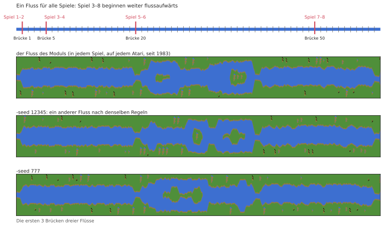

## Blöcke, Abschnitte und Brücken

Der Fluss wird aus Stücken fester Länge gebaut:

```
  Block      = 32 Zeilen
  Abschnitt  = 2 Blöcke (64 Zeilen)
  16 Abschnitte von einer Brücke zur nächsten (1 024 Zeilen, etwa 17 Sekunden bei normaler Geschwindigkeit)
```

Am Anfang jedes Blocks und Abschnitts entscheidet der Generator, was als Nächstes kommt
(`countLines`). Der letzte Abschnitt vor einer Brücke ist besonders: keine Insel, feste Breite, und
sein zweiter Block ist eine gerade Anfahrt, immer gleich geformt, die in der Brücke mit einer Straße
über die Ufer endet. Die Uferfarbe wechselt von Brücke zu Brücke zwischen zwei Grüntönen.

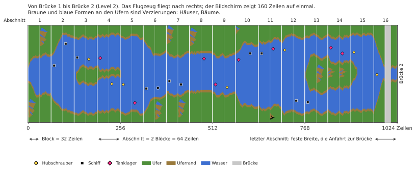

Das **Level** ist einfach die Nummer der Brücke, auf die Sie zufliegen. Es macht den Fluss schwerer:
engere Kurven, mehr Gegner, weniger Tanklager. Bei 80 hört es auf zu steigen; danach wechselt das
Spiel zwischen den Levels 79 und 80, sodass sich ungerade und gerade Levels weiter abwechseln.

## Die Ufer

In jeder Zeile macht das linke Ufer einen Schritt: Es bleibt, wo es ist, oder rückt einen Punkt nach
links oder rechts (`moveBank`). Ob es weitergeht, anhält oder umkehrt, entscheiden die Zufallszahlen,
aber in Grenzen, die vom Level abhängen: In den ersten beiden Brücken schlängelt sich der Fluss kaum,
später schwingt er über den größten Teil des Bildschirms. Vor jedem Schritt prüft das Ufer außerdem,
dass es nicht in das Objekt läuft, das gerade oben platziert wird; so werden Gegner nie im Ufer
begraben.

Das rechte Ufer ergibt sich aus dem linken: Wasserbreite plus Inselbreite. Ungerade und gerade Levels
unterscheiden sich:

- **ungerade Levels:** Der Fluss behält dieselbe Breite und windet sich weiter; gegen Ende der Strecke
  wird er zur Bildschirmmitte zurückgezogen;
- **gerade Levels:** Jeder Abschnitt kann eine neue Breite haben (`chooseSectionWidth`), und es
  erscheinen Inseln. Eine Insel öffnet sich über einen Abschnitt der Breite 0 (der Fluss teilt sich),
  bleibt eine Weile und schließt sich auf dieselbe Art. Die Breite ändert sich allmählich, um ein oder
  zwei Punkte pro Zeile (`changeIsland`), sodass die Ufer sanfte Schrägen bilden.

An manchen Blockanfängen wird eine **Verzierung** auf ein Ufer gesetzt: ein Haus, ein Baum, ein Berg
(`startDecoration`). Sie wird Zeile für Zeile aus kleinen Bildern im Modul gezeichnet, auf der Seite,
die Platz hat.

Jede Zeile wird schließlich aus ganzen Bytes in Ufer- und Wasserfarbe zusammengesetzt, mit kurzen,
fertigen „Randstücken“ dort, wo Wasser auf Land trifft, sodass das Ufer an jedem Punkt enden kann
(`drawLine`).

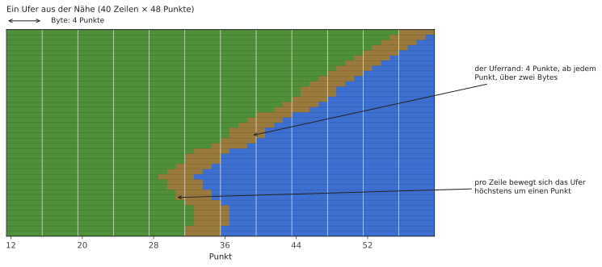

## Gegner, Treibstoff und Brücken

Der Bildschirm ist in **11 waagerechte Streifen** („Slots“) geteilt; jeder enthält höchstens ein
Objekt. Alle 16 Zeilen kommt oben ein neues Objekt in den nächsten freien Streifen (`placeObject`):

- am Blockanfang: ein Gegner, ein Tanklager oder nichts. Je höher das Level, desto seltener die
  Tanklager (ab Level 46 wird es nicht schlimmer);
- mitten im Block, ab Level 9: vielleicht ein Gegner, umso öfter, je höher das Level; ab Level 40
  jedes Mal;
- auf der Anfahrt zu einer Brücke: die Brücke selbst.

Welcher Gegner, entscheiden die Zufallszahlen (`chooseEnemy`): Schiff oder Hubschrauber je dreimal
von acht, Düsenjäger oder Heißluftballon je einmal. Düsenjäger gibt es erst ab Level 5, Ballons ab
Level 3 und nur am Blockanfang; wo der Fluss zu schmal ist, wird aus einem Schiff ein Hubschrauber.
Ab Level 13 ist hin und wieder ein Hubschrauber einer, der Raketen auf Sie schießt (immer nur einer
gleichzeitig).

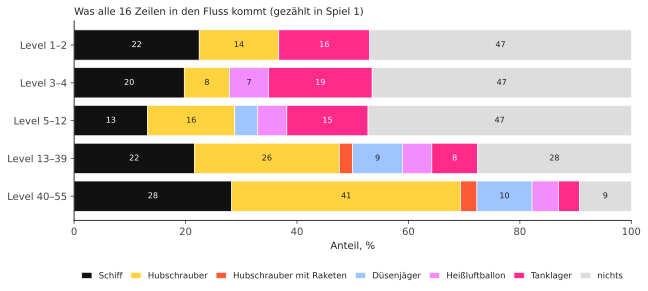

Wo quer über den Fluss das Objekt steht, hängt vom Level ab: auf ungeraden Levels irgendwo, zufällig;
auf geraden neben dem einen oder anderen Ufer oder neben der Insel (`positionObject`). Es schaut vom
näheren Ufer weg.

| Objekt | Punkte |
|---|---|
| Schiff | 30 |
| Hubschrauber | 60 |
| Heißluftballon | 60 |
| Tanklager | 80 |
| Düsenjäger | 100 |
| Hubschrauber, der schießt | 150 |
| Brücke | 500 |
| Brücke mit Panzer darauf | 750 |

Alle 10 000 Punkte gibt es ein zusätzliches Flugzeug, bis zu 9.

## Bewegung

Anfangs bewegen sich die Objekte nicht von selbst: Alle 16 Bilder wird ein zufälliger Streifen
„geweckt“ (`mainLoop`), und von da an bewegt sich sein Objekt seitwärts. Schiffe und Hubschrauber
bewegen sich jedes zweite Bild (ungerade und gerade Streifen abwechselnd), Ballons noch halb so oft,
Düsenjäger jedes Bild. Berührt ein Objekt den Uferrand, kehrt es einmal um. Düsenjäger fliegen quer
hinüber und tauchen auf der anderen Bildschirmseite wieder auf. Vor Brücke 2 bewegt sich nichts, und
nichts bewegt sich, solange Sie nicht fliegen.

**Panzer** fahren auf den Straßen: über eine Brücke, und ab Level 7 auf Straßen quer über die Ufer.
Ein Panzer auf einer Uferstraße fährt zum Fluss, hält am Wasser und feuert eine Granate hinüber; die
Granate fliegt im Bogen und explodiert und zerstört, worauf sie fällt, auch Ihr Flugzeug
(`driveTank`, `moveShell`). Ab Brücke 5 bringt eine gesprengte Brücke einen Panzer in der Nähe zum
Feuern.

## Warum es schwerer wird

Die Zufallszahlen allein entscheiden nichts: Die Folge ist das ganze Spiel über dieselbe. Was sich
ändert, ist, wie das Spiel sie liest. Fast jede Entscheidung des Generators vergleicht eine
Zufallszahl (0 bis 255) mit einer Schwelle, die aus dem Level berechnet wird, und die Schwellen
verschieben sich mit steigendem Level. Dieselben Zufallszahlen, die an Brücke 5 eine leere Strecke
ergaben, ergeben an Brücke 25 einen Gegner.

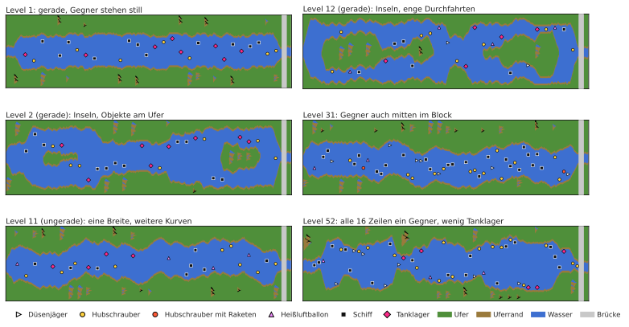

**Gegner mitten im Block.** Schwelle: (Level − 8) × 8.

| Level | Wahrscheinlichkeit eines Gegners |
|---|---|
| bis 8 | keine (Gegner nur am Blockanfang) |
| 10 | 16 von 256, etwa 6 % |
| 20 | 96 von 256, etwa 38 % |
| 30 | 176 von 256, etwa 69 % |
| ab 40 | jedes Mal |

**Tanklager.** Am Blockanfang ist die Schwelle (63 − Level) × 2. Darüber kommt ein Gegner; darunter
in der Hälfte der Fälle ein Tanklager, sonst nichts. Ein Tanklager kommt an etwa 24 % der
Blockanfänge in Level 1, 17 % in Level 20 und 6,6 % in Level 46 (danach nicht seltener), während
Gegner dort von etwa 51 % auf 87 % steigen.

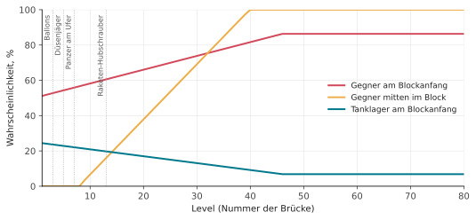

**Neue Gegner nach Level.**

| ab Level | was erscheint |
|---|---|
| 3 | Heißluftballons |
| 5 | Düsenjäger (vorher stattdessen ein Schiff); eine gesprengte Brücke bringt einen Panzer in der Nähe zum Feuern |
| 7 | Panzer auf den Uferstraßen |
| 13 | Hubschrauber, die Raketen schießen |

**Wie stark sich der Fluss windet.** Die Grenzen, in denen das Ufer wandert, werden weiter: In den
Levels 1 und 2 ist der Fluss fast gerade (das Ufer bewegt sich in etwa 8 Positionen); später etwa
15; auf ungeraden Levels ab 10 etwa 39 und ab 20 fast über den ganzen Bildschirm.

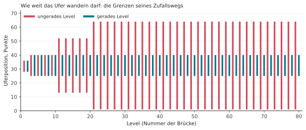

**Platz an den Ufern.** Unter Level 9 halten Objekte ein paar Punkte mehr Abstand zu den Ufern, und
Abschnitte sind nie sehr schmal; unter Level 20 wird die schmalste Abschnittsbreite nicht verwendet.

**Bewegung.** Vor Brücke 2 bewegen sich Gegner überhaupt nicht.

Deshalb speichern die Spiele 3–8, die an Brücke 5, 20 oder 50 beginnen, für ihren Start zwei Dinge:
den Zustand des Generators an dieser Brücke, der die Form des Flusses ergibt, und die Levelnummer, die
seine Schwierigkeit ergibt. Ohne das Level hätte der Fluss dieselbe Form, wäre aber leicht.

## Ihr Flugzeug

- **Geschwindigkeit:** nach vorn schneller, nach hinten langsamer; loslassen, und sie kehrt zur
  normalen zurück (`changeSpeed`).
- **Lenken:** Je länger Sie den Knüppel halten, desto schneller wird das Flugzeug seitwärts
  (`steer`).
- **Treibstoff:** Ein voller Tank reicht etwa 34 Sekunden. Über einem Tanklager füllt sich ein
  leerer Tank in etwa 2 Sekunden; unter einem Viertel piept eine Warnung. Ein leerer Tank ist ein
  Absturz.
- **Feuern:** eine Kugel auf einmal; sie fliegt 6 Zeilen pro Bild nach oben, bis sie etwas trifft
  oder das Ufer.

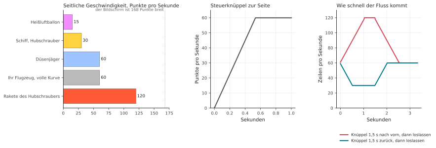

Sie verlieren ein Flugzeug, wenn Sie das Ufer, einen Gegner oder eine Brücke berühren, durch eine
Panzergranate oder eine Hubschrauberrakete, oder wenn der Treibstoff ausgeht. Der Fluss beginnt dann
an der letzten Brücke neu (dafür merkt sich der Generator seinen Zustand an jeder Brücke:
`sectionCheckpoint`, `restoreCheckpoint`); das Flugzeug wartet, bis Sie den Knüppel bewegen. Im
Spiel zu zweit wechseln sich die Spieler nach jedem verlorenen Flugzeug ab.

## Woher es weiß, was was getroffen hat

Der Fluss selbst ist nur ein Bild im Speicher: Punkte in vier Farben. Alles, was sich darüber
bewegt, zeichnet der Videochip getrennt, über dem Bild, als *Sprite*. Der Atari hat acht davon, und
seine Handbücher nennen sie **Player** und **Missiles**:

- **Player 0, 1, 2, 3**: vier Sprites, 8 Punkte breit (der Chip kann einen auch auf 16 oder 32
  Punkte strecken: Schiffe sind doppelt breit gezeichnet, Brücken vierfach). Jeder ist ein Streifen
  so hoch wie der Bildschirm, mit eigener Farbe; das Programm sagt, wo er waagerecht steht und
  welche seiner 8 Punkte in jeder Zeile leuchten;
- **Missiles 0, 1, 2, 3**: vier weitere, nur 2 Punkte breit, für Geschosse gedacht.

Die Namen stammen aus den Spielen, für die der Chip entworfen wurde: Die Figur jedes Spielers war ein
„Player“, ihre Schüsse waren „Missiles“. Mit den Menschen, die River Raid spielen, haben sie nichts
zu tun, und die Nummern sind einfach die Zählung des Chips. Ein Sprite zu bewegen heißt nur, seine
Position zu ändern; das Flussbild darunter bleibt unberührt. River Raid verwendet sie so:

| Sprite | zeigt |
|---|---|
| Player 2 | Ihr Flugzeug |
| Missile 2 | Ihre Kugel |
| Player 1 | den Panzer auf der Straße |
| Player 0 | seine Granate |
| Missile 0 | die Rakete des Hubschraubers |
| Player 3 | **alle** Gegner, Tanklager und Brücken |

Wie kann ein Sprite elf Objekte zeigen? Während das Bild Zeile für Zeile von oben nach unten
gezeichnet wird, unterbricht sich das Spiel an gewählten Zeilen selbst (ein *Display-List-
Interrupt*). In jedem Streifen setzt es Player 3 auf das Objekt dieses Streifens, stellt Breite und
Farben ein und liefert ihm die Form des Objekts Zeile für Zeile. Dasselbe Sprite wird so den ganzen
Bildschirm hinunter wiederverwendet (`display`).

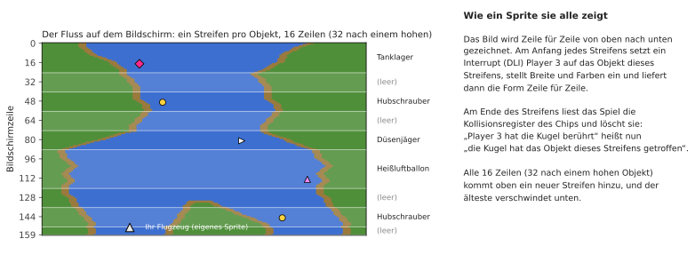

Der Videochip des Atari erfasst außerdem **Kollisionen** von selbst: Sobald in einer gezeichneten
Zeile Punkte eines Sprites auf Punkte eines anderen Sprites oder auf die Uferfarben fallen, setzt er
ein Bit in einem Kollisionsregister. Direkt nach jedem Streifen liest das Spiel diese Register und
löscht sie. So weiß es genau, welchen Streifen und damit welches Objekt die Kugel oder das Flugzeug
berührt hat, ohne selbst etwas zu berechnen. „Das Flugzeug hat das Ufer berührt“ heißt ebenso nur
„Player 2 hat die Uferfarbe überdeckt“. Nur das Grün zählt: Der braune Rand, 4 Punkte breit, wird
für das Flugzeug nicht geprüft, es darf ihn also streifen.

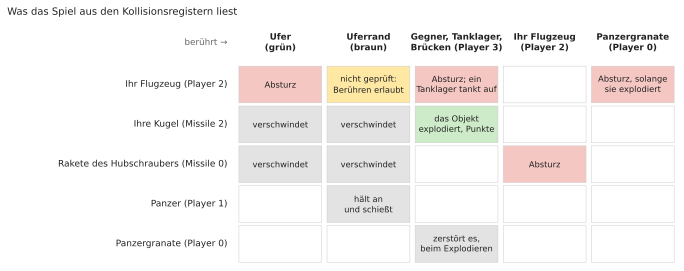

Weil diese Abfragen während des Zeichnens geschehen, kommt es auf den genauen Moment an: Berührt die
Kugel ein Objekt nur genau in der Zeile, in der das Register gelesen wird, hängt es davon ab, wie
weit der Elektronenstrahl in dieser Zeile schon ist, ob das zählt. Die Portierung bildet das nach,
indem sie den Interrupt-Code mit der Zeit jedes Befehls ausführt, Zeile für Zeile.

## Wenn niemand spielt

Ohne Spiel läuft der **Demo-Modus**: Der Fluss zieht ohne Flugzeug vorbei, Gegner bewegen sich, und
die Laufschrift unter der Anzeige zeigt die Mitwirkenden und „Press START“. Ein Tastendruck auf der
Tastatur hält das Spiel an, ein weiterer setzt es fort. Nach sehr langer Zeit ohne Eingabe (etwa 73
Minuten) bleibt das Spiel stehen, bis etwas gedrückt wird.

## Sound

Der Soundchip des Atari hat vier Stimmen; das Spiel stellt sie 60-mal pro Sekunde ein
(`soundDriver`):

1. der Motor, dessen Tonhöhe der Geschwindigkeit folgt und dessen Klang sich ändert, wenn Sie den
   Knüppel drücken oder ziehen; er wird ersetzt durch die Treibstoffwarnung, das Tankgeräusch oder
   einen Absturz;
2. Explosionen (Rauschen) und die Rakete des Hubschraubers;
3. Ihre Schüsse und die Fanfare eines zusätzlichen Flugzeugs;
4. das Pfeifen der fallenden Panzergranate und ihre Explosion.
