# Cómo funciona River Raid

[English](HOW_IT_WORKS.md) | [Русский](HOW_IT_WORKS.ru.md) | [Українська](HOW_IT_WORKS.uk.md) | [Deutsch](HOW_IT_WORKS.de.md) | [Polski](HOW_IT_WORKS.pl.md) | [Italiano](HOW_IT_WORKS.it.md) | Español | [中文](HOW_IT_WORKS.zh.md) | [日本語](HOW_IT_WORKS.ja.md)

Esta es una explicación para cualquier curioso, sin necesidad de saber programar: cómo River Raid para
los Atari de 8 bits (Activision, 1983) construye su río sin fin, coloca enemigos y puentes y averigua
qué chocó con qué. Todo lo de aquí se leyó del programa original y se comparó con él fotograma a
fotograma (vea [port/README.es.md](../port/README.es.md)). Los números se dan tal como los usa el juego; donde ayuda, entre
paréntesis va el nombre de la función correspondiente en el código del port. Las imágenes están
dibujadas con el generador del río del port, en colores sencillos propios (`tools/doc_figures.py`).

## La pantalla

El juego muestra 60 imágenes por segundo (en una máquina NTSC americana; 59,92 para ser exactos). La
zona del río mide 160 líneas de alto y 192 puntos de ancho, y cada punto es de uno de cuatro colores:
orilla (verde), el borde entre orilla y agua, agua (azul) y negro donde no hay nada dibujado. Debajo
está el panel: indicador de combustible, puntos, vidas, contador de puentes y una línea deslizante
con el logotipo de Activision.

El avión siempre se queda abajo en la pantalla. Lo que se mueve es el río: cada cierto tiempo se
dibuja una línea nueva arriba y todo lo demás baja una. A velocidad normal es una línea por imagen,
60 líneas por segundo; empujar la palanca hacia delante lo duplica y tirar hacia atrás lo reduce a la
mitad (`scrollRiver`). En ningún sitio se guarda un río entero: cada línea existe solo desde que se
dibuja arriba hasta que sale por abajo.

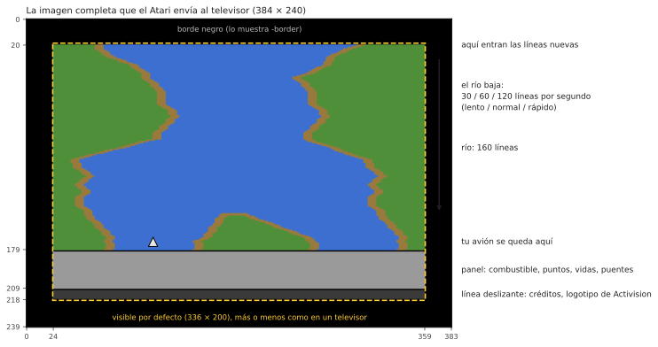

## Un río que siempre es el mismo

El río de River Raid parece aleatorio, pero es idéntico en cada partida y en cada Atari desde 1983.
Viene de un generador de números *pseudoaleatorios*: un "registro de desplazamiento" de 24 bits que
se remueve una vez por línea con una regla fija (`stepLfsr`). Arrancado desde el mismo valor, siempre
produce la misma secuencia de números, así que las mismas curvas, islas y enemigos aparecen en los
mismos sitios. Los puntos de inicio de las partidas 1–8 (puente 1, 5, 20 o 50) son los estados de ese
registro, y la posición de la orilla, en esos puentes del mismo río, guardados para que el juego no
tenga que recorrer el río hasta ellos.

La opción `-seed N` del port arranca el mismo registro desde otro valor: las reglas siguen siendo las
mismas y el río es otro.

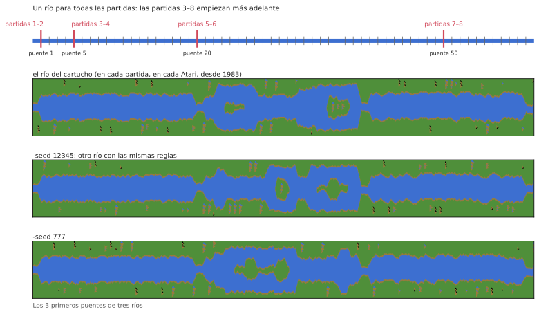

## Bloques, secciones y puentes

El río se construye con piezas de longitud fija:

```
  bloque   = 32 líneas
  sección  = 2 bloques (64 líneas)
  16 secciones de un puente al siguiente (1 024 líneas, unos 17 segundos a velocidad normal)
```

Al principio de cada bloque y sección el generador decide qué viene después (`countLines`). La última
sección antes de un puente es especial: sin isla, de ancho fijo, y su segundo bloque es una llegada
recta, siempre con la misma forma, que termina en el puente con una carretera que cruza las orillas.
El color de la orilla alterna entre dos verdes de un puente al siguiente.

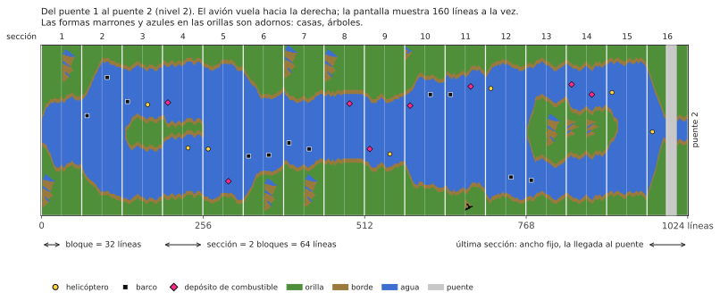

El **nivel** es simplemente el número del puente hacia el que vuela. Hace el río más difícil: curvas
más cerradas, más enemigos, menos depósitos de combustible. Deja de crecer en 80; a partir de ahí el
juego alterna entre los niveles 79 y 80, así que los niveles impares y pares siguen turnándose.

## Las orillas

En cada línea la orilla izquierda da un paso: se queda donde está o se mueve un punto a la izquierda
o a la derecha (`moveBank`). Si sigue, se detiene o da la vuelta lo deciden los números aleatorios,
pero dentro de límites que dependen del nivel: durante los dos primeros puentes el río apenas
serpentea, después recorre la mayor parte de la pantalla. Antes de dar el paso, la orilla comprueba
además que no chocará con el objeto que se está colocando arriba, así que los enemigos nunca quedan
enterrados en la orilla.

La orilla derecha se deduce de la izquierda: ancho del agua más ancho de la isla. Los niveles impares
y pares son distintos:

- **niveles impares:** el río mantiene el mismo ancho y serpentea más; cerca del final del tramo se
  le devuelve hacia el centro de la pantalla;
- **niveles pares:** cada sección puede tener un ancho nuevo (`chooseSectionWidth`) y aparecen islas.
  Una isla se abre a través de una sección de ancho 0 (el río se divide), se mantiene un rato y se
  cierra del mismo modo. El ancho cambia poco a poco, uno o dos puntos por línea (`changeIsland`), así
  que las orillas forman pendientes suaves.

Al principio de algunos bloques se coloca un **adorno** en una orilla: una casa, un árbol, una montaña
(`startDecoration`). Se dibuja fila a fila a partir de pequeñas imágenes guardadas en el cartucho, en
el lado donde hay sitio.

Por último, cada línea se arma con bytes enteros del color de la orilla y del agua, con breves
"piezas de borde" ya hechas donde el agua se encuentra con la tierra, para que la orilla pueda
terminar en cualquier punto (`drawLine`).

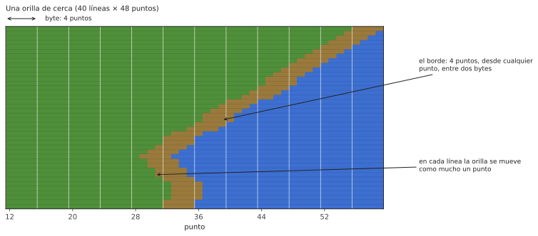

## Enemigos, combustible y puentes

La pantalla está dividida en **11 franjas horizontales** ("slots"); cada una contiene como mucho un
objeto. Cada 16 líneas entra un objeto nuevo por arriba, en la siguiente franja libre (`placeObject`):

- al principio de un bloque: un enemigo, un depósito de combustible o nada. Cuanto más alto el nivel,
  más escasos los depósitos (a partir del nivel 46 ya no empeora);
- a mitad de un bloque, desde el nivel 9: quizá un enemigo, más a menudo cuanto más alto el nivel;
  desde el nivel 40, siempre;
- en la llegada a un puente: el propio puente.

Qué enemigo es lo deciden los números aleatorios (`chooseEnemy`): un barco o un helicóptero tres
veces de cada ocho cada uno, un caza o un globo una vez cada uno. Los cazas solo aparecen desde el
nivel 5, los globos desde el nivel 3 y solo al principio de un bloque; donde el río es demasiado
estrecho, un barco se convierte en helicóptero. Desde el nivel 13, de vez en cuando, un helicóptero es
de los que le disparan misiles (solo uno a la vez).

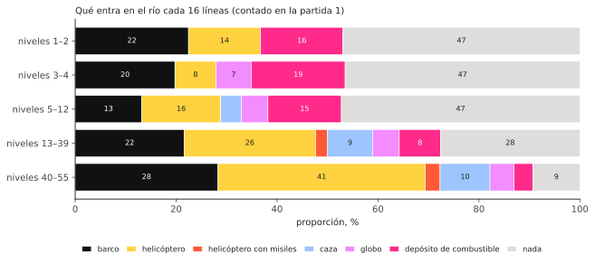

Dónde queda el objeto a lo ancho del río depende del nivel: en los niveles impares en cualquier
sitio, al azar; en los pares junto a una orilla u otra, o junto a la isla (`positionObject`). Mira
hacia el lado contrario a la orilla más cercana.

| objeto | puntos |
|---|---|
| barco | 30 |
| helicóptero | 60 |
| globo | 60 |
| depósito de combustible | 80 |
| caza | 100 |
| helicóptero que dispara | 150 |
| puente | 500 |
| puente con un tanque encima | 750 |

Cada 10 000 puntos se gana un avión extra, hasta 9.

## Movimiento

Al principio los objetos no se mueven solos: cada 16 imágenes una franja al azar se "despierta"
(`mainLoop`) y a partir de entonces su objeto se mueve de lado. Barcos y helicópteros se mueven una
imagen sí y otra no (las franjas impares y pares por turnos), los globos la mitad de eso, los cazas
en cada imagen. Cuando un objeto toca el borde de la orilla, da la vuelta una vez. Los cazas cruzan
toda la pantalla y reaparecen por el otro lado. Nada se mueve antes del puente 2, y nada se mueve
mientras no esté volando.

Los **tanques** circulan por las carreteras: cruzando un puente y, desde el nivel 7, por carreteras
que cruzan las orillas. Un tanque en una carretera de la orilla va hacia el río, se detiene junto al
agua y dispara un proyectil al otro lado; el proyectil vuela en arco y explota, destruyendo lo que
haya donde cae, incluido su avión (`driveTank`, `moveShell`). Desde el puente 5, volar un puente hace
que un tanque cercano dispare.

## Por qué se vuelve más difícil

Los números aleatorios por sí solos no deciden nada: la secuencia es la misma toda la partida. Lo que
cambia es cómo los lee el juego. Casi cada decisión del generador compara un número aleatorio (de 0 a
255) con un umbral calculado a partir del nivel, y los umbrales se desplazan a medida que sube el
nivel. Los mismos números aleatorios que en el puente 5 daban un tramo vacío dan un enemigo en el
puente 25.

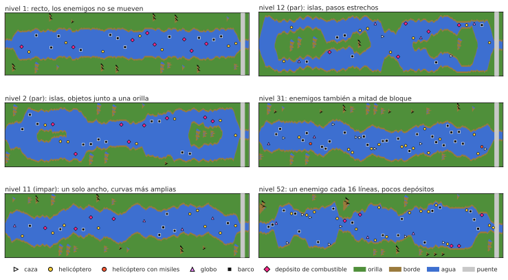

**Enemigos a mitad de bloque.** Umbral: (nivel − 8) × 8.

| nivel | probabilidad de un enemigo |
|---|---|
| hasta 8 | ninguna (enemigos solo al principio del bloque) |
| 10 | 16 de 256, cerca del 6% |
| 20 | 96 de 256, cerca del 38% |
| 30 | 176 de 256, cerca del 69% |
| desde 40 | siempre |

**Depósitos de combustible.** Al principio de un bloque el umbral es (63 − nivel) × 2. Por encima
llega un enemigo; por debajo, la mitad de las veces un depósito y si no, nada. Aparece un depósito en
cerca del 24% de los inicios de bloque en el nivel 1, el 17% en el nivel 20 y el 6,6% en el nivel 46
(después no es más raro), mientras que los enemigos allí pasan de cerca del 51% al 87%.

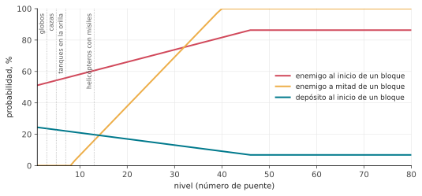

**Enemigos nuevos por nivel.**

| desde el nivel | qué aparece |
|---|---|
| 3 | globos |
| 5 | cazas (antes, en su lugar, un barco); un puente volado hace que un tanque cercano dispare |
| 7 | tanques en las carreteras de las orillas |
| 13 | helicópteros que disparan misiles |

**Cuánto serpentea el río.** Los límites dentro de los que vaga la orilla se ensanchan: en los niveles
1 y 2 el río es casi recto (la orilla se mueve dentro de unas 8 posiciones); después unas 15; en los
niveles impares desde el 10 unas 39, y desde el 20 casi por toda la pantalla.

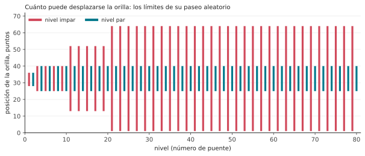

**Espacio junto a las orillas.** Por debajo del nivel 9 los objetos se mantienen unos puntos más
lejos de las orillas y las secciones nunca son muy estrechas; por debajo del nivel 20 no se usa el
ancho de sección más estrecho.

**Movimiento.** Antes del puente 2 los enemigos no se mueven en absoluto.

Por eso las partidas 3–8, que empiezan en el puente 5, 20 o 50, guardan dos cosas para su inicio: el
estado del generador en ese puente, que da la forma del río, y el número de nivel, que da su
dificultad. Sin el nivel, el río tendría la misma forma pero sería fácil.

## Su avión

- **Velocidad:** hacia delante es más rápido y hacia atrás más lento; al soltar, vuelve a la normal
  (`changeSpeed`).
- **Dirección:** el avión acelera de lado cuanto más tiempo mantiene la palanca (`steer`).
- **Combustible:** un depósito lleno dura unos 34 segundos. Sobrevolando un depósito, uno vacío se
  llena en unos 2 segundos; por debajo de un cuarto suena un aviso. Un depósito vacío es un choque.
- **Disparo:** una bala a la vez; sube 6 líneas por imagen hasta que da con algo o con la orilla.

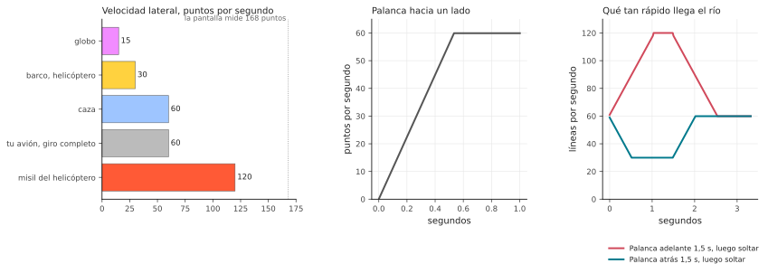

Se pierde un avión al tocar la orilla, cualquier enemigo o un puente, por un proyectil de tanque o un
misil de helicóptero, o al quedarse sin combustible. Entonces el río vuelve a empezar desde el último
puente (para ello el generador recuerda su estado en cada puente: `sectionCheckpoint`,
`restoreCheckpoint`); el avión espera hasta que mueva la palanca. En la partida a dos, los jugadores
se turnan después de cada avión perdido.

## Cómo sabe qué chocó con qué

El río en sí es solo una imagen en memoria: puntos de cuatro colores. Todo lo que se mueve encima lo
dibuja el chip de vídeo por separado, sobre la imagen, como un *sprite*. El Atari tiene ocho, y sus
manuales los llaman **players** y **missiles**:

- **players 0, 1, 2, 3**: cuatro sprites de 8 puntos de ancho (el chip también puede estirar uno a 16
  o 32 puntos: los barcos se dibujan a doble ancho, los puentes a cuádruple). Cada uno es una franja
  tan alta como la pantalla, con su propio color; el programa dice dónde está a lo ancho y cuáles de
  sus 8 puntos se encienden en cada línea;
- **missiles 0, 1, 2, 3**: otros cuatro, de solo 2 puntos de ancho, pensados para las balas.

Los nombres vienen de los juegos para los que se diseñó el chip, donde el personaje de cada jugador
era un "player" y sus disparos eran "missiles"; no tienen nada que ver con las personas que juegan a
River Raid. Los números son simplemente la numeración del chip. Mover un sprite solo significa
cambiar su posición; la imagen del río de debajo queda intacta. River Raid los usa así:

| sprite | muestra |
|---|---|
| player 2 | su avión |
| missile 2 | su bala |
| player 1 | el tanque en la carretera |
| player 0 | su proyectil |
| missile 0 | el misil del helicóptero |
| player 3 | **todos** los enemigos, depósitos y puentes |

¿Cómo puede un sprite mostrar once objetos? Mientras se dibuja la imagen, línea a línea de arriba
abajo, el juego se interrumpe a sí mismo en líneas elegidas (una *interrupción de la lista de
visualización*). En cada franja lleva el player 3 al objeto de esa franja, le pone ancho y colores y
le pasa la forma del objeto línea a línea. El mismo sprite se reutiliza a lo largo de la pantalla
(`display`).

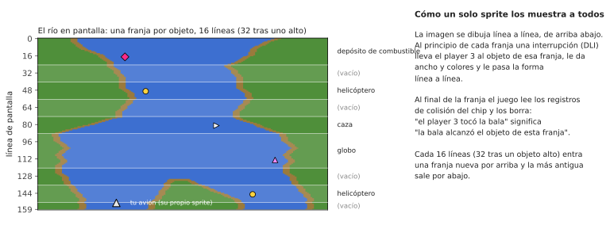

El chip de vídeo del Atari también registra por sí solo las **colisiones**: cada vez que, en una
línea que se está dibujando, los puntos de un sprite caen sobre puntos de otro sprite o sobre los
colores de la orilla, pone un bit en un registro de colisión. Justo después de cada franja el juego
lee estos registros y los borra. Así sabe exactamente qué franja, y por tanto qué objeto, tocó la bala
o el avión, sin hacer ningún cálculo propio. "El avión chocó con la orilla" es también solo "el player
2 se superpuso al color de la orilla". Solo cuenta el verde: el borde marrón, de 4 puntos de ancho, no
se comprueba para el avión, así que puede rozarlo.

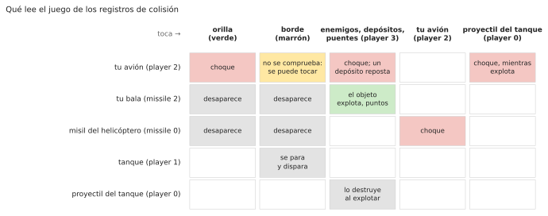

Como estas lecturas ocurren mientras se dibuja la imagen, el momento exacto importa: si la bala toca
un objeto solo justo en la línea donde se lee el registro, que cuente o no depende de cuánto haya
avanzado el haz de electrones por esa línea. El port lo reproduce ejecutando el código de la
interrupción con el tiempo que tarda cada instrucción, línea a línea.

## Cuando nadie juega

Sin partida, el programa ejecuta su **modo de demostración**: el río pasa sin avión, los enemigos se
mueven y la línea bajo el panel muestra los créditos y "Press START". Pulsar una tecla del teclado
pausa el juego y pulsar otra lo reanuda. Tras muchísimo tiempo sin ninguna entrada (unos 73 minutos)
el juego se queda quieto hasta que se pulse algo.

## Sonido

El chip de sonido del Atari tiene cuatro voces; el juego las ajusta 60 veces por segundo
(`soundDriver`):

1. el motor, cuyo tono sigue a la velocidad y cuyo timbre cambia al empujar o tirar de la palanca; lo
   sustituyen el aviso de combustible bajo, el sonido de repostar o un choque;
2. las explosiones (ruido) y el misil del helicóptero;
3. sus disparos y la fanfarria de un avión extra;
4. el silbido del proyectil del tanque al caer y su explosión.
