# Come funziona River Raid

[English](HOW_IT_WORKS.md) | [Русский](HOW_IT_WORKS.ru.md) | [Українська](HOW_IT_WORKS.uk.md) | [Deutsch](HOW_IT_WORKS.de.md) | [Polski](HOW_IT_WORKS.pl.md) | Italiano | [Español](HOW_IT_WORKS.es.md) | [中文](HOW_IT_WORKS.zh.md) | [日本語](HOW_IT_WORKS.ja.md)

Questa è una spiegazione per i curiosi, senza bisogno di saper programmare: come River Raid per gli
Atari a 8 bit (Activision, 1983) costruisce il suo fiume senza fine, piazza nemici e ponti e scopre
cosa ha colpito cosa. Tutto qui è stato letto dal programma originale e confrontato con esso
fotogramma per fotogramma (vedi [port/README.it.md](../port/README.it.md)). I numeri sono dati come li usa il gioco; dove
aiuta, tra parentesi c'è il nome della funzione corrispondente nel codice del port. Le immagini sono
disegnate con il generatore del fiume del port, con colori semplici propri (`tools/doc_figures.py`).

## Lo schermo

Il gioco mostra 60 immagini al secondo (su una macchina americana NTSC; 59,92 per la precisione).
L'area del fiume è alta 160 righe e larga 192 punti, e ogni punto è di uno di quattro colori: riva
(verde), il bordo tra riva e acqua, acqua (blu) e nero dove non c'è nulla. Sotto c'è il pannello:
indicatore del carburante, punti, vite, contatore dei ponti e una riga che scorre con il logo di
Activision.

L'aereo resta sempre in basso nello schermo. A muoversi è il fiume: ogni tanto in alto viene
disegnata una riga nuova e tutto il resto scende di una. A velocità normale è una riga per immagine,
60 righe al secondo; la leva in avanti la raddoppia, tirata indietro la dimezza (`scrollRiver`). Un
fiume intero non è memorizzato da nessuna parte: ogni riga esiste solo dal momento in cui viene
disegnata in alto finché non esce dal fondo.

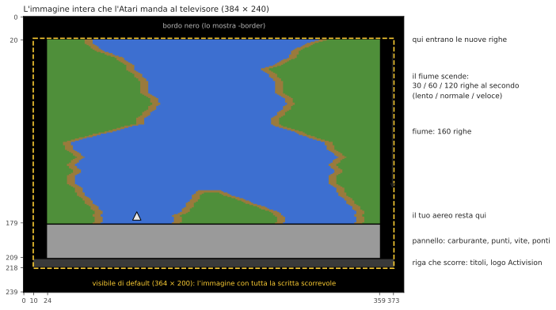

## Un fiume sempre uguale

Il fiume di River Raid sembra casuale, ma dal 1983 è identico in ogni partita, su ogni Atari. Viene
da un generatore di numeri *pseudocasuali*: un "registro a scorrimento" a 24 bit, rimescolato una
volta per riga con una regola fissa (`stepLfsr`). Partendo dallo stesso valore produce sempre la
stessa sequenza di numeri, quindi le stesse curve, isole e nemici compaiono negli stessi punti. I
punti di partenza dei giochi 1–8 (ponte 1, 5, 20 o 50) sono gli stati di quel registro, e la
posizione della riva, a quei ponti dello stesso fiume, salvati perché il gioco non debba far scorrere
il fiume fino a lì.

L'opzione `-seed N` del port fa partire lo stesso registro da un altro valore: le regole restano le
stesse, il fiume è un altro.

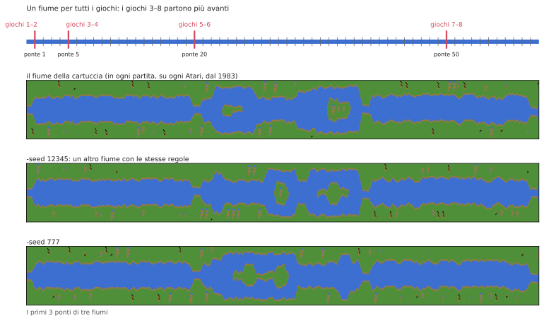

## Blocchi, sezioni e ponti

Il fiume è costruito a pezzi di lunghezza fissa:

```
  blocco   = 32 righe
  sezione  = 2 blocchi (64 righe)
  16 sezioni da un ponte al successivo (1 024 righe, circa 17 secondi a velocità normale)
```

All'inizio di ogni blocco e sezione il generatore decide cosa viene dopo (`countLines`). L'ultima
sezione prima di un ponte è speciale: niente isola, larghezza fissa, e il suo secondo blocco è un
avvicinamento dritto, sempre della stessa forma, che finisce nel ponte con una strada attraverso le
rive. Il colore della riva alterna due verdi da un ponte all'altro.

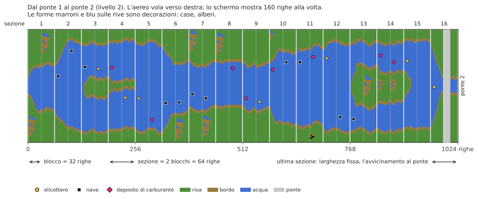

Il **livello** è semplicemente il numero del ponte verso cui si vola. Rende il fiume più difficile:
curve più strette, più nemici, meno depositi di carburante. Smette di crescere a 80; da lì il gioco
alterna i livelli 79 e 80, così livelli dispari e pari continuano ad alternarsi.

## Le rive

A ogni riga la riva sinistra fa un passo: resta dov'è o si sposta di un punto a sinistra o a destra
(`moveBank`). Se continuare, fermarsi o tornare indietro lo decidono i numeri casuali, ma entro
limiti che dipendono dal livello: nei primi due ponti il fiume serpeggia appena, poi si muove per
gran parte dello schermo. Prima di fare il passo, la riva controlla anche di non finire
sull'oggetto che viene piazzato in alto, così i nemici non restano mai sepolti nella riva.

La riva destra deriva da quella sinistra: larghezza dell'acqua più larghezza dell'isola. I livelli
dispari e pari sono diversi:

- **livelli dispari:** il fiume mantiene la stessa larghezza e fa curve più ampie; verso la fine del
  tratto viene riportato verso il centro dello schermo;
- **livelli pari:** ogni sezione può avere una nuova larghezza (`chooseSectionWidth`) e compaiono
  isole. Un'isola si apre attraverso una sezione di larghezza 0 (il fiume si divide), resta per un
  po' e si chiude allo stesso modo. La larghezza cambia gradualmente, di uno o due punti per riga
  (`changeIsland`), così le rive formano pendii dolci.

All'inizio di alcuni blocchi sulla riva viene messa una **decorazione**: una casa, un albero, una
montagna (`startDecoration`). Viene disegnata riga per riga da piccole immagini conservate nella
cartuccia, dal lato dove c'è spazio.

Infine ogni riga viene composta da byte interi del colore della riva e dell'acqua, con brevi "pezzi
di bordo" già pronti dove l'acqua incontra la terra, così la riva può finire su qualsiasi punto
(`drawLine`).

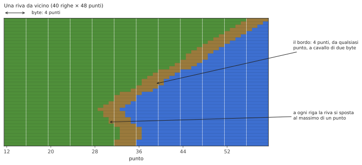

## Nemici, carburante e ponti

Lo schermo è diviso in **11 fasce orizzontali** ("slot"); ognuna contiene al massimo un oggetto.
Ogni 16 righe un nuovo oggetto entra in alto, nella prossima fascia libera (`placeObject`):

- all'inizio di un blocco: un nemico, un deposito di carburante o niente. Più alto è il livello, più
  rari sono i depositi (dopo il livello 46 non peggiora più);
- a metà blocco, dal livello 9: forse un nemico, tanto più spesso quanto più alto è il livello; dal
  livello 40 ogni volta;
- sull'avvicinamento a un ponte: il ponte stesso.

Quale nemico lo decidono i numeri casuali (`chooseEnemy`): una nave o un elicottero tre volte su
otto ciascuno, un caccia o una mongolfiera una volta ciascuno. I caccia arrivano solo dal livello 5,
le mongolfiere dal livello 3 e solo all'inizio di un blocco; dove il fiume è troppo stretto una nave
diventa un elicottero. Dal livello 13, ogni tanto, un elicottero è uno che vi spara missili (solo
uno alla volta).

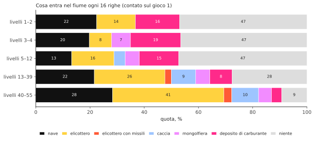

Dove l'oggetto si trova attraverso il fiume dipende dal livello: sui livelli dispari ovunque, a
caso; sui pari accanto a una riva o all'altra, o accanto all'isola (`positionObject`). È rivolto
dalla parte opposta alla riva più vicina.

| oggetto | punti |
|---|---|
| nave | 30 |
| elicottero | 60 |
| mongolfiera | 60 |
| deposito di carburante | 80 |
| caccia | 100 |
| elicottero che spara | 150 |
| ponte | 500 |
| ponte con un carro armato | 750 |

Ogni 10 000 punti si guadagna un aereo in più, fino a 9.

## Movimento

All'inizio gli oggetti non si muovono da soli: ogni 16 immagini una fascia a caso viene "svegliata"
(`mainLoop`) e da quel momento il suo oggetto si sposta di lato. Navi ed elicotteri si muovono
un'immagine sì e una no (fasce dispari e pari a turno), le mongolfiere ancora la metà, i caccia a ogni
immagine. Quando un oggetto tocca il bordo della riva si gira una volta. I caccia attraversano tutto
lo schermo e ricompaiono dall'altro lato. Prima del ponte 2 non si muove niente, e niente si muove
finché non si vola.

I **carri armati** viaggiano sulle strade: attraverso un ponte e, dal livello 7, su strade attraverso
le rive. Un carro su una strada di riva va verso il fiume, si ferma sulla sponda e spara un proiettile
dall'altra parte; il proiettile vola ad arco ed esplode, distruggendo ciò su cui cade, compreso il
vostro aereo (`driveTank`, `moveShell`). Dal ponte 5 in poi, far saltare un ponte fa sparare un carro
vicino.

## Perché diventa più difficile

I numeri casuali da soli non decidono nulla: la sequenza è la stessa per tutta la partita. Cambia il
modo in cui il gioco li legge. Quasi ogni decisione del generatore confronta un numero casuale (da 0
a 255) con una soglia calcolata dal livello, e le soglie si spostano con il crescere del livello. Gli
stessi numeri casuali che al ponte 5 davano un tratto vuoto al ponte 25 danno un nemico.

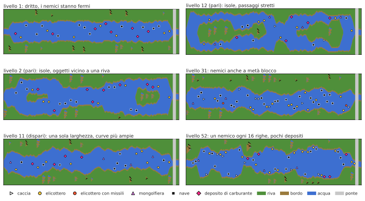

**Nemici a metà blocco.** Soglia: (livello − 8) × 8.

| livello | probabilità di un nemico |
|---|---|
| fino a 8 | nessuna (nemici solo a inizio blocco) |
| 10 | 16 su 256, circa 6% |
| 20 | 96 su 256, circa 38% |
| 30 | 176 su 256, circa 69% |
| da 40 | ogni volta |

**Depositi di carburante.** A inizio blocco la soglia è (63 − livello) × 2. Sopra arriva un nemico;
sotto, metà delle volte un deposito, altrimenti niente. Un deposito arriva a circa il 24% degli
inizi di blocco al livello 1, il 17% al livello 20 e il 6,6% al livello 46 (non più raro dopo),
mentre lì i nemici passano da circa il 51% all'87%.

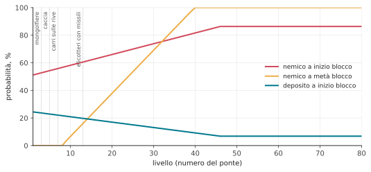

**Nuovi nemici per livello.**

| dal livello | cosa compare |
|---|---|
| 3 | mongolfiere |
| 5 | caccia (prima, al loro posto, una nave); un ponte fatto saltare fa sparare un carro vicino |
| 7 | carri armati sulle strade delle rive |
| 13 | elicotteri che sparano missili |

**Quanto serpeggia il fiume.** I limiti entro cui vaga la riva si allargano: ai livelli 1 e 2 il
fiume è quasi dritto (la riva si muove entro circa 8 posizioni); poi circa 15; sui livelli dispari
dal 10 circa 39 e dal 20 quasi su tutto lo schermo.

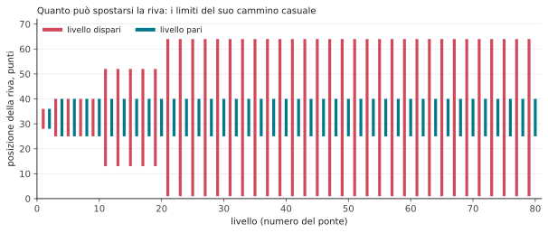

**Spazio vicino alle rive.** Sotto il livello 9 gli oggetti stanno qualche punto più lontani dalle
rive e le sezioni non sono mai molto strette; sotto il livello 20 la larghezza di sezione più stretta
non viene usata.

**Movimento.** Prima del ponte 2 i nemici non si muovono affatto.

Per questo i giochi 3–8, che partono dal ponte 5, 20 o 50, salvano due cose per la partenza: lo stato
del generatore a quel ponte, che dà la forma del fiume, e il numero del livello, che ne dà la
difficoltà. Senza il livello il fiume avrebbe la stessa forma ma sarebbe facile.

## Il vostro aereo

- **Velocità:** avanti è più veloce, indietro più lento; lasciando la leva torna normale
  (`changeSpeed`).
- **Sterzata:** l'aereo accelera di lato quanto più a lungo si tiene la leva (`steer`).
- **Carburante:** un pieno dura circa 34 secondi. Sorvolando un deposito un serbatoio vuoto si riempie
  in circa 2 secondi; sotto un quarto suona un avviso. Serbatoio vuoto vuol dire schianto.
- **Fuoco:** un proiettile alla volta; sale di 6 righe per immagine finché non colpisce qualcosa o la
  riva.

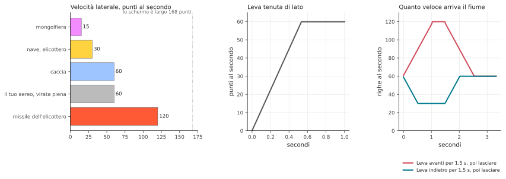

Si perde un aereo toccando la riva, un nemico o un ponte, per un proiettile di carro o un missile di
elicottero, o restando senza carburante. Il fiume allora riparte dall'ultimo ponte (per questo il
generatore ricorda il suo stato a ogni ponte: `sectionCheckpoint`, `restoreCheckpoint`); l'aereo
aspetta che muoviate la leva. Nella partita a due i giocatori si danno il turno dopo ogni aereo perso.

## Come sa cosa ha colpito cosa

Il fiume in sé è solo un'immagine in memoria: punti di quattro colori. Tutto ciò che si muove sopra
viene disegnato dal chip video a parte, sopra l'immagine, come *sprite*. L'Atari ne ha otto, e i suoi
manuali li chiamano **player** e **missile**:

- **player 0, 1, 2, 3**: quattro sprite larghi 8 punti (il chip può anche allargarne uno a 16 o 32
  punti: le navi sono disegnate a larghezza doppia, i ponti quadrupla). Ognuno è una striscia alta
  quanto lo schermo, con un colore proprio; il programma dice dove si trova in orizzontale e quali
  dei suoi 8 punti sono accesi in ogni riga;
- **missile 0, 1, 2, 3**: altri quattro, larghi solo 2 punti, pensati per i proiettili.

I nomi vengono dai giochi per cui il chip era stato progettato, dove il personaggio di ogni giocatore
era un "player" e i suoi colpi erano "missile"; non hanno nulla a che fare con le persone che giocano
a River Raid. I numeri sono semplicemente la numerazione del chip. Spostare uno sprite vuol dire solo
cambiarne la posizione; l'immagine del fiume sotto resta intatta. River Raid li usa così:

| sprite | mostra |
|---|---|
| player 2 | il vostro aereo |
| missile 2 | il vostro proiettile |
| player 1 | il carro armato sulla strada |
| player 0 | il suo proiettile |
| missile 0 | il missile dell'elicottero |
| player 3 | **tutti** i nemici, i depositi e i ponti |

Come può uno sprite mostrare undici oggetti? Mentre l'immagine viene disegnata, riga per riga
dall'alto in basso, il gioco interrompe sé stesso a righe scelte (un *display list interrupt*). In
ogni fascia sposta il player 3 sull'oggetto di quella fascia, ne imposta larghezza e colori e gli
passa la forma dell'oggetto riga per riga. Lo stesso sprite viene riusato giù per tutto lo schermo
(`display`).

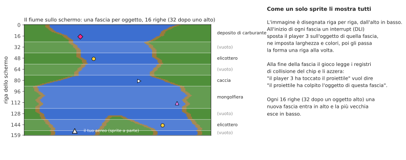

Il chip video dell'Atari registra anche da solo le **collisioni**: ogni volta che, su una riga in
disegno, i punti di uno sprite cadono su punti di un altro sprite o sui colori della riva, imposta un
bit in un registro di collisione. Subito dopo ogni fascia il gioco legge questi registri e li azzera.
Così sa esattamente quale fascia, e quindi quale oggetto, il proiettile o l'aereo hanno toccato,
senza alcun calcolo proprio. "L'aereo ha toccato la riva" è ugualmente solo "il player 2 si è
sovrapposto al colore della riva". Conta solo il verde: il bordo marrone, largo 4 punti, non viene
controllato per l'aereo, che quindi può sfiorarlo.

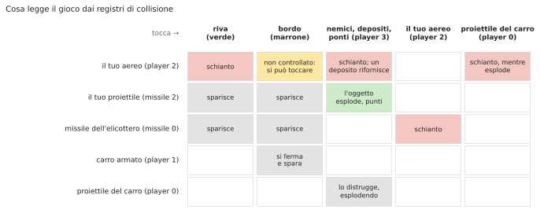

Poiché queste letture avvengono mentre l'immagine viene disegnata, il momento esatto conta: se il
proiettile tocca un oggetto solo proprio sulla riga in cui il registro viene letto, che valga o no
dipende da quanto il fascio elettronico è avanzato su quella riga. Il port lo riproduce eseguendo il
codice dell'interrupt con il tempo di ogni istruzione, riga per riga.

## Quando nessuno gioca

Senza partita il programma esegue la sua **modalità dimostrativa**: il fiume scorre senza aereo, i
nemici si muovono e la riga sotto il pannello mostra i titoli e "Press START". Premere un tasto della
tastiera mette in pausa e premerne un altro riprende. Dopo moltissimo tempo senza alcun input (circa
73 minuti) il gioco si ferma finché non si preme qualcosa.

## Suono

Il chip sonoro dell'Atari ha quattro voci; il gioco le imposta 60 volte al secondo (`soundDriver`):

1. il motore, la cui altezza segue la velocità e il cui timbro cambia quando spingete o tirate la
   leva; viene sostituito dall'avviso di carburante basso, dal suono del rifornimento o da uno
   schianto;
2. le esplosioni (rumore) e il missile dell'elicottero;
3. i vostri colpi e la fanfara di un aereo in più;
4. il fischio del proiettile del carro che cade e la sua esplosione.
