# River Raid のしくみ

[English](HOW_IT_WORKS.md) | [Русский](HOW_IT_WORKS.ru.md) | [Українська](HOW_IT_WORKS.uk.md) | [Deutsch](HOW_IT_WORKS.de.md) | [Polski](HOW_IT_WORKS.pl.md) | [Italiano](HOW_IT_WORKS.it.md) | [Español](HOW_IT_WORKS.es.md) | [中文](HOW_IT_WORKS.zh.md) | 日本語

これは興味のある人のための解説で、プログラミングの知識は必要ありません。8 ビット Atari 版 River Raid（Activision、1983）が、終わりのない川をどう作り、敵と橋をどう配置し、何が何に当たったかをどう知るのかを説明します。ここに書いたことはすべてオリジナルのプログラムから読み取り、1 フレームずつ照合したものです（`port/README.ja.md` を参照）。数値はゲームが使っている形のまま書いています。役に立つ箇所では、移植版のコードで対応する関数の名前を括弧内に示しました。図は移植版の川の生成器から、独自のシンプルな色で描いています（`tools/doc_figures.py`）。

## 画面

ゲームは 1 秒に 60 枚の画面を表示します（アメリカの NTSC 機の場合。正確には 59.92）。川の領域は高さ 160 ライン、幅 192 ドットで、各ドットは 4 色のどれかです。岸（緑）、岸と水の間の縁、水（青）、そして何も描かれていないところの黒です。その下にはパネルがあり、燃料計、得点、残機、橋のカウンター、Activision ロゴの入った流れる文字の行が並びます。

飛行機はいつも画面の下のほうにいます。動いているのは川のほうです。ときどき一番上に新しいラインが描かれ、ほかのすべてが 1 ライン下にずれます。通常の速さでは 1 画面につき 1 ライン、1 秒に 60 ラインです。スティックを前に倒すと倍に、手前に引くと半分になります（`scrollRiver`）。川全体はどこにも保存されていません。各ラインは、上で描かれた瞬間から下の端に流れ出るまでのあいだだけ存在します。

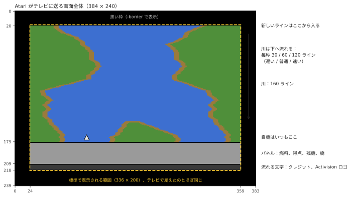

## いつも同じ川

River Raid の川はランダムに見えますが、1983 年からどのゲームでも、どの Atari でもまったく同じです。川は*擬似乱数*の生成器から生まれます。24 ビットの「シフトレジスタ」で、1 ラインごとに決まった規則でかき混ぜられます（`stepLfsr`）。同じ値から始めれば必ず同じ数列が出てくるので、同じカーブ、島、敵が同じ場所に現れます。ゲーム 1–8 のスタート地点（橋 1、5、20、50）は、同じ川のそれらの橋での、このレジスタの状態と岸の位置です。ゲームが川をそこまで進めなくて済むように保存されています。

移植版の `-seed N` は、同じレジスタを別の値から始めます。規則は同じで、川が別のものになります。

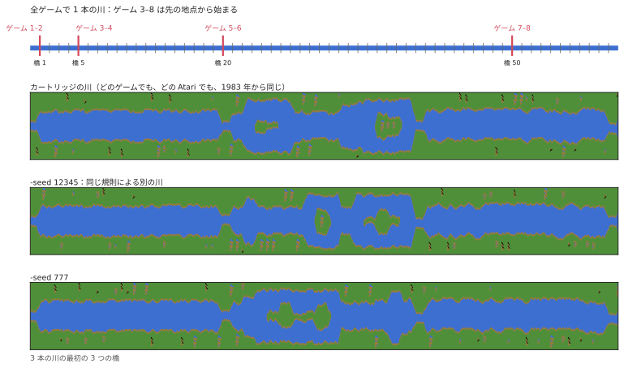

## ブロック、区間、橋

川は決まった長さの部品で組み立てられます。

```
  ブロック = 32 ライン
  区間     = 2 ブロック（64 ライン）
  橋から次の橋まで 16 区間（1 024 ライン、通常の速さで約 17 秒）
```

各ブロックと区間の始まりで、生成器は次に何が来るかを決めます（`countLines`）。橋の手前の最後の区間は特別です。島がなく、幅は一定で、2 つ目のブロックはいつも同じ形のまっすぐなアプローチになっており、両岸を渡る道路のついた橋で終わります。岸の色は橋ごとに 2 種類の緑を交互に使います。

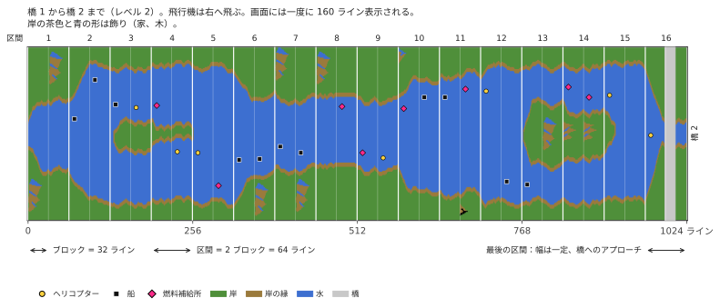

**レベル**とは、いま向かっている橋の番号そのものです。レベルが上がると川は難しくなります。カーブがきつくなり、敵が増え、燃料補給所が減ります。80 で増えるのが止まり、その後は 79 と 80 を交互に繰り返すので、奇数レベルと偶数レベルの交代は続きます。

## 岸

1 ラインごとに左岸は 1 歩進みます。その場にとどまるか、左か右へ 1 ドット動きます（`moveBank`）。進み続けるか、止まるか、向きを変えるかは乱数で決まりますが、その範囲はレベルによって制限されます。最初の 2 つの橋のあいだは川はほとんどくねらず、その後は画面の大部分を行き来します。岸は 1 歩進む前に、上で置かれている最中の物体にぶつからないかも確かめます。そのため敵が岸に埋もれることはありません。

右岸は左岸から決まります。水の幅に島の幅を足したものです。奇数レベルと偶数レベルで違いがあります。

- **奇数レベル：**川は同じ幅のまま、大きくくねります。区間の終わりが近づくと画面の中央へ引き戻されます。
- **偶数レベル：**区間ごとに新しい幅にでき（`chooseSectionWidth`）、島が現れます。島は幅 0 の区間を通して開き（川が分かれる）、しばらく続いて、同じ方法で閉じます。幅は 1 ラインに 1〜2 ドットずつ少しずつ変わるので（`changeIsland`）、岸はなだらかな斜面になります。

いくつかのブロックの始まりでは、岸に**飾り**が置かれます。家、木、山です（`startDecoration`）。カートリッジに入っている小さな絵から 1 行ずつ、余裕のある側に描かれます。

最後に、各ラインは岸の色と水の色のバイト単位のかたまりで組み立てられ、水と陸の境目にはあらかじめ用意された短い「縁の部品」が使われます。こうして岸はどのドットでも終われます（`drawLine`）。

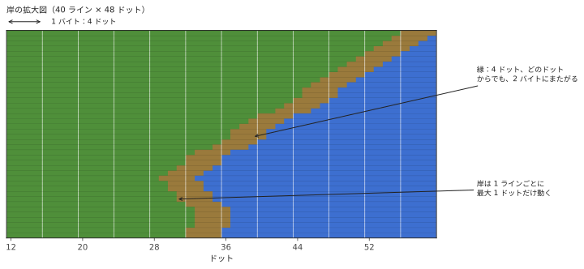

## 敵、燃料、橋

画面は **11 本の横の帯**（「スロット」）に分かれていて、それぞれに入る物体は多くても 1 つです。16 ラインごとに新しい物体が上から入り、次の空いている帯に入ります（`placeObject`）。

- ブロックの始まり：敵か、燃料補給所か、何もなし。レベルが高いほど補給所は少なくなります（レベル 46 より後はそれ以上減りません）。
- ブロックの途中、レベル 9 から：敵がいるかもしれません。レベルが高いほど多く、レベル 40 からは毎回です。
- 橋へのアプローチ：橋そのもの。

どの敵になるかは乱数で決まります（`chooseEnemy`）。船とヘリコプターがそれぞれ 8 回に 3 回、ジェット機と気球がそれぞれ 1 回です。ジェット機はレベル 5 から、気球はレベル 3 からで、ブロックの始まりにしか出ません。川が狭すぎるところでは船がヘリコプターに変わります。レベル 13 からは、ときどきヘリコプターがあなたにミサイルを撃ってきます（同時に 1 機だけ）。

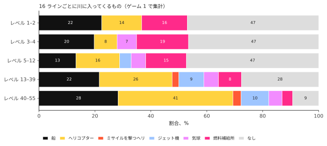

物体が川を横切る方向のどこに置かれるかはレベルで決まります。奇数レベルではどこでもランダムに、偶数レベルではどちらかの岸のそば、または島のそばです（`positionObject`）。近いほうの岸に背を向けて置かれます。

| 物体 | 得点 |
|---|---|
| 船 | 30 |
| ヘリコプター | 60 |
| 気球 | 60 |
| 燃料補給所 | 80 |
| ジェット機 | 100 |
| ミサイルを撃つヘリコプター | 150 |
| 橋 | 500 |
| 戦車の乗った橋 | 750 |

10 000 点ごとに飛行機が 1 機増えます（最大 9 機）。

## 動き

最初は物体は自分では動きません。16 画面ごとにランダムな帯が 1 本「起こされ」（`mainLoop`）、それ以降その物体が横に動きます。船とヘリコプターは 1 画面おきに動き（奇数と偶数の帯が交互に）、気球はさらにその半分、ジェット機は毎画面動きます。物体は岸の縁に触れると 1 回だけ向きを変えます。ジェット機は画面を横切って反対側から再び現れます。橋 2 より前では何も動かず、あなたが飛んでいないあいだも何も動きません。

**戦車**は道路を走ります。橋の上を渡るほか、レベル 7 からは岸を横切る道路も走ります。岸の道路の戦車は川へ向かい、水際で止まって向こう岸へ砲弾を撃ちます。砲弾は弧を描いて飛んで爆発し、落ちた場所にあるものを、あなたの飛行機も含めて破壊します（`driveTank`、`moveShell`）。橋 5 からは、橋を爆破すると近くの戦車が撃ってきます。

## なぜ難しくなるのか

乱数そのものは何も決めません。数列はゲームのあいだずっと同じです。変わるのは、ゲームがそれをどう読むかです。生成器のほとんどすべての判断は、乱数（0〜255）をレベルから計算したしきい値と比べており、レベルが上がるにつれてしきい値が動きます。橋 5 では何もない区間になった同じ乱数が、橋 25 では敵になります。

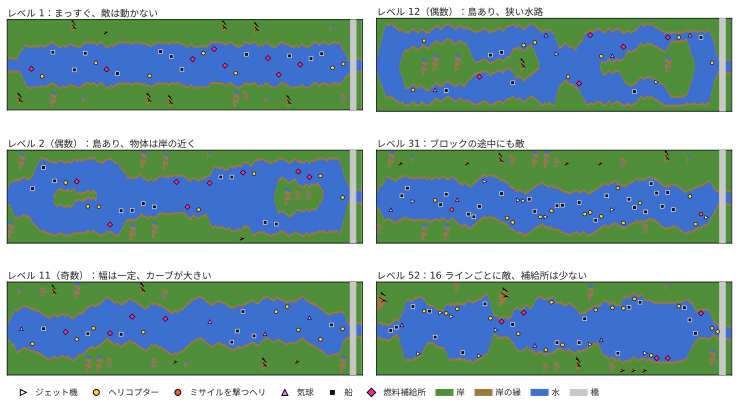

**ブロック途中の敵。**しきい値：（レベル − 8）× 8。

| レベル | 敵が出る確率 |
|---|---|
| 8 まで | なし（敵はブロックの始まりだけ） |
| 10 | 256 分の 16、約 6% |
| 20 | 256 分の 96、約 38% |
| 30 | 256 分の 176、約 69% |
| 40 以上 | 毎回 |

**燃料補給所。**ブロックの始まりでのしきい値は（63 − レベル）× 2 です。それより上なら敵、下なら半分の確率で補給所、そうでなければ何もなしです。補給所はレベル 1 でブロックの始まりの約 24%、レベル 20 で 17%、レベル 46 で 6.6%（それ以降は減らない）に現れ、そこでの敵は約 51% から 87% に増えます。

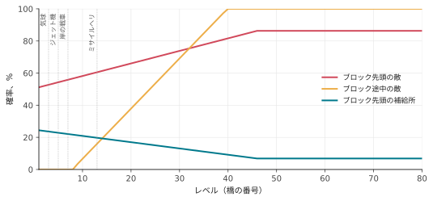

**レベルごとに増える敵。**

| レベル | 現れるもの |
|---|---|
| 3 | 気球 |
| 5 | ジェット機（それまでは代わりに船）。橋を爆破すると近くの戦車が撃つ |
| 7 | 岸の道路の戦車 |
| 13 | ミサイルを撃つヘリコプター |

**川のくねり具合。**岸がさまよう範囲は広がっていきます。レベル 1 と 2 では川はほぼまっすぐ（岸は約 8 位置の範囲で動く）、その後は約 15、奇数レベルではレベル 10 から約 39、レベル 20 からは画面のほぼ全体です。

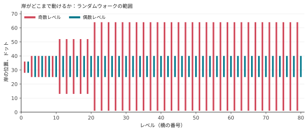

**岸のそばの余裕。**レベル 9 未満では、物体は岸から数ドット余分に離れ、区間がとても狭くなることもありません。レベル 20 未満では、いちばん狭い区間の幅は使われません。

**動き。**橋 2 より前では、敵はまったく動きません。

そのため、橋 5、20、50 から始まるゲーム 3–8 は、スタートのために 2 つのものを保存しています。その橋での生成器の状態（川の形を決める）と、レベルの番号（難しさを決める）です。レベルがなければ、川の形は同じでも簡単になってしまいます。

## 自機

- **速さ：**前に倒すと速く、後ろに倒すと遅くなり、離すと通常に戻ります（`changeSpeed`）。
- **旋回：**スティックを横に倒している時間が長いほど、飛行機は速く横へ動きます（`steer`）。
- **燃料：**満タンで約 34 秒もちます。補給所の上を飛ぶと、空のタンクが約 2 秒で満タンになります。4 分の 1 を切ると警告音が鳴ります。燃料切れは墜落です。
- **射撃：**弾は一度に 1 発。何かか岸に当たるまで、1 画面に 6 ラインずつ上へ飛びます。

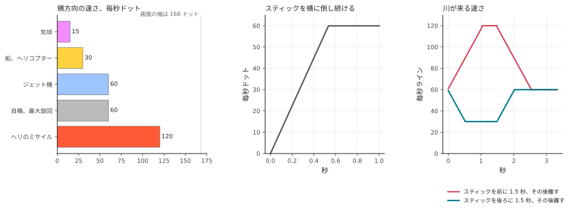

岸、敵、橋に触れたとき、戦車の砲弾やヘリのミサイルに当たったとき、燃料が切れたときに飛行機を 1 機失います。すると川は直前の橋からやり直しになります（そのために生成器は橋ごとの状態を覚えています：`sectionCheckpoint`、`restoreCheckpoint`）。飛行機はあなたがスティックを動かすまで待ちます。2 人プレイでは、飛行機を失うたびにプレイヤーが交代します。

## 何が何に当たったかを知るしくみ

川そのものはメモリ上の絵にすぎません。4 色のドットです。その上を動くものはすべて、ビデオチップが絵とは別に、絵の上に*スプライト*として描きます。Atari には 8 つあり、マニュアルではそれを**プレイヤー**（player）と**ミサイル**（missile）と呼んでいます。

- **プレイヤー 0、1、2、3**：幅 8 ドットのスプライト 4 つ（チップは 16 ドットや 32 ドットに引き伸ばすこともできます。船は 2 倍幅、橋は 4 倍幅で描かれます）。それぞれ画面と同じ高さの帯で、自分の色を持ちます。プログラムは、横方向のどこに置くかと、各ラインで 8 ドットのどれを光らせるかを指定します。
- **ミサイル 0、1、2、3**：もう 4 つ。幅はわずか 2 ドットで、弾のためのものです。

名前は、このチップが作られたときに想定していたゲームから来ています。各プレイヤーのキャラクターが「プレイヤー」、その弾が「ミサイル」でした。River Raid を遊ぶ人とは関係がなく、番号もチップの中の番号にすぎません。スプライトを動かすには位置を変えるだけでよく、その下の川の絵には手を触れません。River Raid は次のように使っています。

| スプライト | 表示するもの |
|---|---|
| プレイヤー 2 | 自機 |
| ミサイル 2 | 自機の弾 |
| プレイヤー 1 | 道路の戦車 |
| プレイヤー 0 | その砲弾 |
| ミサイル 0 | ヘリのミサイル |
| プレイヤー 3 | **すべての**敵、補給所、橋 |

1 つのスプライトでどうやって 11 個の物体を表示するのでしょうか。画面が上から下へ 1 ラインずつ描かれているあいだ、ゲームは選んだラインで自分自身に割り込みをかけます（*ディスプレイリスト割り込み*）。各帯で、プレイヤー 3 をその帯の物体の位置へ動かし、幅と色を設定し、物体の形を 1 ラインずつ渡します。こうして同じスプライトが画面の上から下まで使い回されます（`display`）。

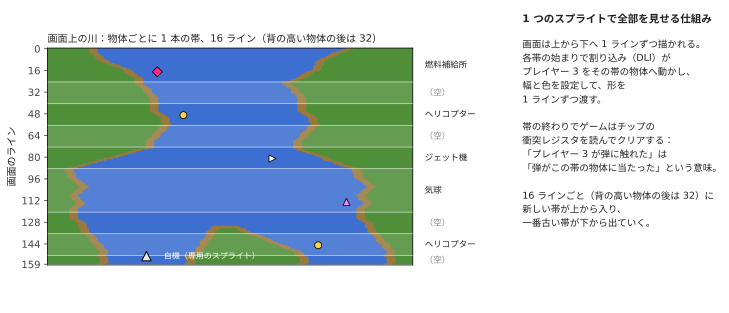

Atari のビデオチップは**衝突**も自分で記録します。描画中のラインで、あるスプライトのドットが別のスプライトのドットや岸の色に重なると、衝突レジスタのビットを立てます。各帯の直後に、ゲームはこのレジスタを読んでクリアします。これで、弾や飛行機がどの帯、つまりどの物体に触れたかを、自分では何も計算せずに正確に知ることができます。「飛行機が岸にぶつかった」も同じく「プレイヤー 2 が岸の色に重なった」というだけのことです。数えるのは緑だけで、幅 4 ドットの茶色い縁は飛行機については判定されないので、かすめても大丈夫です。

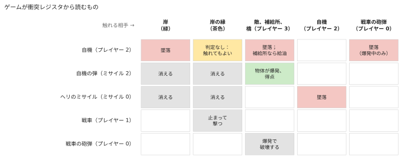

これらの読み取りは画面を描いている最中に行われるので、正確なタイミングが重要です。弾がレジスタを読むまさにそのラインでだけ物体に触れた場合、それが数えられるかどうかは、電子ビームがそのラインをどこまで進んだかで決まります。移植版は、割り込みのコードを各命令にかかる時間どおりに、走査線ごとに実行することでこれを再現しています。

## 誰も遊んでいないとき

ゲームをしていないとき、プログラムは**デモモード**を流します。飛行機なしで川が流れ、敵が動き、パネルの下の流れる文字がクレジットと「Press START」を表示します。キーボードのキーを押すと一時停止し、もう一度押すと再開します。何も入力のないまま非常に長い時間（約 73 分）が過ぎると、何かが押されるまでゲームは止まったままになります。

## サウンド

Atari のサウンドチップには 4 つの声部があり、ゲームはそれを 1 秒に 60 回設定します（`soundDriver`）。

1. エンジン。音の高さは速さに合わせて変わり、スティックを押したり引いたりすると音色が変わります。燃料警告、給油の音、墜落の音に置き換わることがあります。
2. 爆発（ノイズ）とヘリのミサイル。
3. あなたの射撃と、ボーナス機のファンファーレ。
4. 落ちてくる戦車の砲弾のヒューという音と、その爆発。
