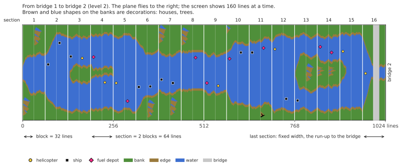
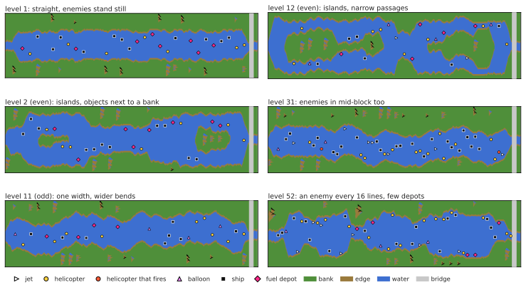
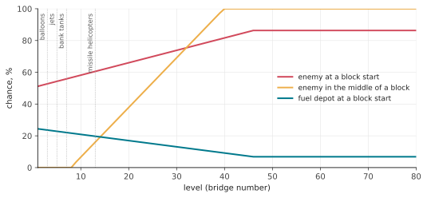
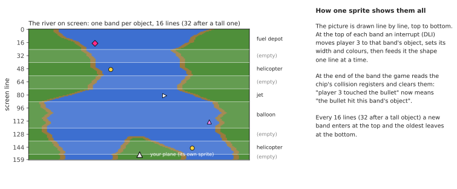

# How River Raid works

This is an explanation for anyone curious, no programming knowledge needed: how the Atari 8-bit
River Raid (Activision, 1983) builds its endless river, places enemies and bridges, and finds
out what hit what. Everything here was read out of the original program and checked against
it frame by frame (see `port/README.md`). Numbers are given as the game uses them; where it
helps, the name of the matching function in the port's code is in brackets. The pictures are
drawn from the port's river generator in plain colours of their own (`tools/doc_figures.py`).

## The screen

The game shows 60 pictures a second (on an American NTSC machine; 59.92 to be exact). The
river area is 160 lines high and 192 dots wide, and every dot is one of four colours: bank
(green), the edge between bank and water, water (blue), and black where nothing is drawn.
Below it is the status panel: fuel gauge, score, lives, bridge counter, and a scrolling line
with the Activision logo.

The plane always stays near the bottom of the screen. What moves is the river: every so often
a new line is drawn at the top and everything else shifts down by one. At normal speed that is
one line per picture, 60 lines a second; pushing the stick forward doubles it, pulling back
halves it (`scrollRiver`). There is never a whole river stored anywhere: each line exists only
from the moment it is drawn at the top until it scrolls off the bottom.

## A river that is always the same

River Raid's river looks random but is identical in every game, on every Atari, since 1983. It
comes from a *pseudo-random* number generator: a 24-bit "shift register" that is stirred once
per line by a fixed rule (`stepLfsr`). Started from the same value it always produces the same
sequence of numbers, so the same bends, islands and enemies appear in the same places. The
starting points of games 1-8 (bridge 1, 5, 20 or 50) are the states of that register, and the
bank position, at those bridges of the same river, stored so that the game does not have to
run the river up to them.

## Blocks, sections and bridges

The river is built in pieces of fixed length:

```
  block    = 32 lines
  section  = 2 blocks (64 lines)
  16 sections from one bridge to the next (1 024 lines, about 17 seconds at normal speed)
```

At the start of each block and section the generator decides what comes next (`countLines`).
The last section before a bridge is special: no island, a fixed width, and its second block is
a straight run-up, always the same shape, ending in the bridge with a road across the banks.
The bank colour alternates between two greens from one bridge to the next.



The **level** is simply the number of the bridge you are flying towards. It makes the river
harder: tighter bends, more enemies, fewer fuel depots. It stops growing at 80; after that the
game alternates between levels 79 and 80, so odd and even levels keep taking turns.

## The banks

Each line, the left bank takes one step: stays where it is, moves one dot left or right
(`moveBank`). Whether it keeps going, stops or turns round is decided by the random numbers,
but within limits that depend on the level: during the first two bridges the river barely
wiggles, later it swings across most of the screen. Before stepping, the bank also checks that
it would not run into the object being placed at the top, so enemies are never buried in the
bank.

The right bank follows from the left one: water width plus island width. Odd and even levels
differ:

- **odd levels:** the river keeps the same width and winds more widely; near the end of the
  stretch it is pulled back towards the middle of the screen;
- **even levels:** every section can have a new width (`chooseSectionWidth`), and islands
  appear. An island opens through a section of width 0 (the river splits), stays for a while,
  and closes the same way. When the width changes, it does so gradually, by one or two dots per
  line (`changeIsland`), so the banks form smooth slopes.

At some block starts a **decoration** is placed on a bank: a house, a tree, a mountain
(`startDecoration`). It is drawn row by row from small pictures stored in the cartridge, on
whichever side has room.

Each line is finally assembled from whole bytes of bank and water colour, with short ready-made
"edge pieces" where water meets land, so the shore can stop at any dot (`drawLine`).

## Enemies, fuel and bridges

The screen is divided into **11 horizontal bands** ("slots"); each holds at most one object.
Every 16 lines a new object enters at the top, in the next free band (`placeObject`):

- at the start of a block: an enemy, or a fuel depot, or nothing. The higher the level, the
  rarer the fuel depots (this stops getting worse after level 46);
- in the middle of a block, from level 9 on: perhaps an enemy, more often the higher the level;
  from level 40 every time;
- on a bridge's run-up: the bridge itself.

Which enemy is a matter of the random numbers (`chooseEnemy`): a ship or a helicopter three
times in eight each, a jet or a hot-air balloon once each. Jets only come from level 5, balloons
from level 3 and only at block starts; where the river is too narrow a ship becomes a
helicopter. From level 13, now and then, a helicopter is one that fires missiles at you (only
one of those at a time).

Where across the river the object goes depends on the level: on odd levels anywhere, at
random; on even levels next to one bank or the other, or beside the island
(`positionObject`). It faces away from the nearer bank.

| object | points |
|---|---|
| ship | 30 |
| helicopter | 60 |
| hot-air balloon | 60 |
| fuel depot | 80 |
| jet | 100 |
| helicopter that fires | 150 |
| bridge | 500 |
| bridge with a tank on it | 750 |

Every 10 000 points gives an extra plane, up to 9.

## Movement

Objects do not move by themselves at first: every 16 pictures one random band is "woken up"
(`mainLoop`), and from then on its object moves sideways. Ships and helicopters move every
other picture (odd and even bands take turns), balloons half as often again, jets every
picture. When an object touches the bank edge it turns round once. Jets fly right across and
reappear on the other side of the screen. Nothing moves before bridge 2, and nothing moves
while you are not flying.

**Tanks** drive on the roads: across a bridge, and from level 7 on roads across the banks. A
tank on a bank road drives towards the river, stops at the water's edge and fires a shell across
it; the shell flies in an arc and explodes, destroying whatever it lands on, including your
plane (`driveTank`, `moveShell`). From bridge 5 on, blowing up a bridge makes a nearby tank fire.

## Why it gets harder

The random numbers alone decide nothing: the sequence is the same all game long. What changes
is how the game reads them. Almost every decision of the generator compares a random number
(0 to 255) with a threshold computed from the level, and the thresholds move as the level
grows. The same random numbers that gave an empty stretch at bridge 5 give an enemy at bridge
25.



**Enemies in the middle of a block.** Threshold: (level − 8) × 8.

| level | chance of an enemy |
|---|---|
| up to 8 | none (enemies only at block starts) |
| 10 | 16 in 256, about 6% |
| 20 | 96 in 256, about 38% |
| 30 | 176 in 256, about 69% |
| 40 and up | every time |

**Fuel depots.** At a block start the threshold is (63 − level) × 2. Above it comes an enemy;
below it a fuel depot half the time, otherwise nothing. A depot comes at about 24% of block
starts at level 1, 17% at level 20 and 6.6% at level 46 (no rarer after that), while enemies
there go from about 51% to 87%.



**New enemies by level.**

| from level | what appears |
|---|---|
| 3 | hot-air balloons |
| 5 | jets (before that, a ship instead); a blown-up bridge makes a nearby tank fire |
| 7 | tanks on the bank roads |
| 13 | helicopters that fire missiles |

**How much the river winds.** The limits within which the bank wanders widen: at levels 1 and 2
the river is almost straight (the bank moves within about 8 positions); later about 15; on odd
levels from 10 on about 39, and from 20 on almost the whole screen.

**Room at the banks.** Below level 9, objects keep a few dots further from the banks and
sections are never very narrow; below level 20 the narrowest section width is not used.

**Movement.** Before bridge 2 enemies do not move at all.

This is also why games 3-8, which start at bridge 5, 20 or 50, store two things for their start:
the generator's state at that bridge, which gives the shape of the river, and the level number,
which gives its difficulty. Without the level the river would have the same shape but be easy.

## Your plane

- **Speed:** forward is faster, back is slower; let go and it returns to normal (`changeSpeed`).
- **Steering:** the plane accelerates sideways the longer you hold the stick (`steer`).
- **Fuel:** a full tank lasts about 34 seconds. Flying over a depot fills an empty tank in about
  2 seconds; below a quarter a warning beeps. An empty tank is a crash.
- **Firing:** one bullet at a time; it flies up 6 lines per picture until it hits something or
  the bank.

You lose a plane by touching the bank, any enemy or a bridge, by a tank shell or a helicopter's
missile, or by running out of fuel. The river then restarts from the last bridge (the generator
remembers its state at every bridge for this: `sectionCheckpoint`, `restoreCheckpoint`); the
plane waits until you move the stick. In a two-player game the players take turns after each
lost plane.

## How it knows what hit what

The Atari has very little graphics hardware: four small *sprites* ("players"), each 8 dots wide,
plus four narrow ones ("missiles"), drawn over the background. River Raid uses them like this:

| sprite | shows |
|---|---|
| player 2 | your plane |
| missile 2 | your bullet |
| player 1 | the tank on the road |
| player 0 | its shell |
| missile 0 | the helicopter's missile |
| player 3 | **all** enemies, depots and bridges |

How can one sprite show eleven objects? While the picture is being drawn, line by line from top
to bottom, the game interrupts itself at chosen lines (a *display list interrupt*). In each band
it moves player 3 to that band's object, sets its width and colours, and feeds it the object's
shape line by line. The same sprite is reused down the screen (`display`).



The Atari's video chip also records **collisions** by itself: whenever, on a line being drawn, a
sprite's dots fall on dots of another sprite or of the bank colours, it sets a bit in a
collision register. Right after each band the game reads these registers and clears them. So it
knows exactly which band, and therefore which object, the bullet or the plane touched, without
any calculation of its own. "The plane hit the bank" is likewise just "player 2 overlapped the
bank colour".

Because these reads happen while the picture is being drawn, their exact moment matters: if the
bullet touches an object only on the very line where the register is read, whether that counts
depends on how far the electron beam has got along that line. The port reproduces this by
executing the interrupt code with the time each instruction takes, scanline by scanline.

## When nobody plays

Without a game the program runs its **attract mode**: the river scrolls by with no plane, enemies
move, and the scrolling line under the panel shows the credits and "Press START". Pressing a key
of the keyboard pauses the game and pressing one again continues. After a very long time
without any input (about 73 minutes) the game stands still until something is pressed.

## Sound

The Atari's sound chip has four voices; the game sets them 60 times a second (`soundDriver`):

1. the engine, whose pitch follows the speed and whose tone changes as you push or pull the
   stick; it is replaced by the low-fuel warning, the refuelling sound or a crash;
2. explosions (noise) and the helicopter's missile;
3. your shots, and the fanfare of an extra plane;
4. the tank shell whistling down and exploding.
