# Jak działa River Raid

[English](HOW_IT_WORKS.md) | [Русский](HOW_IT_WORKS.ru.md) | [Українська](HOW_IT_WORKS.uk.md) | [Deutsch](HOW_IT_WORKS.de.md) | Polski | [Italiano](HOW_IT_WORKS.it.md) | [Español](HOW_IT_WORKS.es.md) | [中文](HOW_IT_WORKS.zh.md) | [日本語](HOW_IT_WORKS.ja.md)

To wyjaśnienie dla wszystkich ciekawych, bez znajomości programowania: jak River Raid na 8-bitowe
Atari (Activision, 1983) buduje nieskończoną rzekę, rozmieszcza wrogów i mosty i dowiaduje się, co
w co trafiło. Wszystko tutaj odczytano z oryginalnego programu i porównano z nim klatka po klatce
(zob. [port/README.pl.md](../port/README.pl.md)). Liczby podano tak, jak używa ich gra; tam, gdzie to pomaga, w nawiasach
podano nazwę odpowiedniej funkcji w kodzie portu. Rysunki wykonano generatorem rzeki z portu,
we własnych, prostych kolorach (`tools/doc_figures.py`).

## Ekran

Gra pokazuje 60 obrazów na sekundę (na amerykańskim komputerze NTSC; dokładnie 59,92). Obszar rzeki
ma 160 linii wysokości i 192 punkty szerokości, a każdy punkt ma jeden z czterech kolorów: brzeg
(zielony), skraj między brzegiem a wodą, woda (niebieska) i czerń tam, gdzie nic nie narysowano.
Pod nim jest panel: wskaźnik paliwa, punkty, życia, licznik mostów i przewijany pasek z logo
Activision.

Samolot zawsze zostaje u dołu ekranu. Porusza się rzeka: co jakiś czas na górze rysowana jest nowa
linia, a cała reszta przesuwa się o linię w dół. Przy normalnej prędkości to jedna linia na obraz,
60 linii na sekundę; drążek do przodu podwaja to tempo, do tyłu zmniejsza o połowę (`scrollRiver`).
Cała rzeka nigdzie nie jest przechowywana: każda linia istnieje tylko od chwili narysowania na
górze, dopóki nie zjedzie poza dolną krawędź.

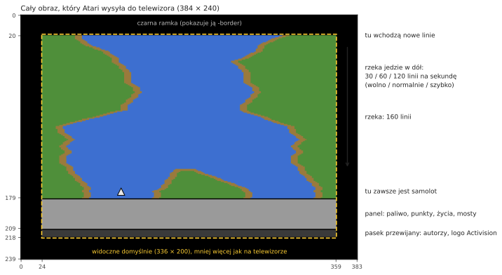

## Rzeka, która zawsze jest taka sama

Rzeka w River Raid wygląda na przypadkową, ale od 1983 roku jest identyczna w każdej grze, na każdym
Atari. Pochodzi z generatora liczb *pseudolosowych*: 24-bitowego „rejestru przesuwnego”, mieszanego
raz na linię według stałej reguły (`stepLfsr`). Uruchomiony od tej samej wartości zawsze daje ten
sam ciąg liczb, więc te same zakręty, wyspy i wrogowie pojawiają się w tych samych miejscach. Punkty
startowe gier 1–8 (most 1, 5, 20 lub 50) to stany tego rejestru i położenie brzegu przy tych mostach
tej samej rzeki, zapisane, żeby gra nie musiała przewijać rzeki aż do nich.

Opcja portu `-seed N` uruchamia ten sam rejestr od innej wartości: reguły zostają te same, rzeka
jest inna.

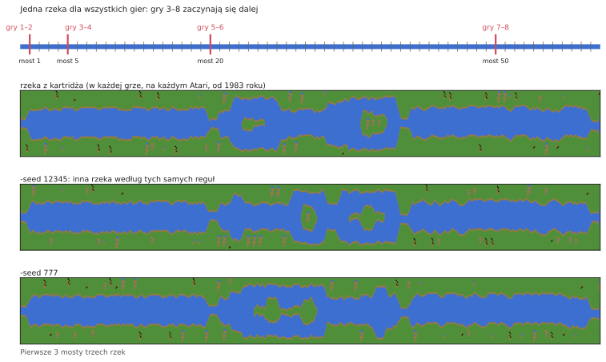

## Bloki, odcinki i mosty

Rzeka jest budowana z kawałków o stałej długości:

```
  blok     = 32 linie
  odcinek  = 2 bloki (64 linie)
  16 odcinków od mostu do mostu (1 024 linie, około 17 sekund przy normalnej prędkości)
```

Na początku każdego bloku i odcinka generator decyduje, co będzie dalej (`countLines`). Ostatni
odcinek przed mostem jest szczególny: bez wyspy, o stałej szerokości, a jego drugi blok to proste
podejście, zawsze tego samego kształtu, kończące się mostem z drogą w poprzek brzegów. Kolor brzegu
zmienia się między dwoma odcieniami zieleni od mostu do mostu.

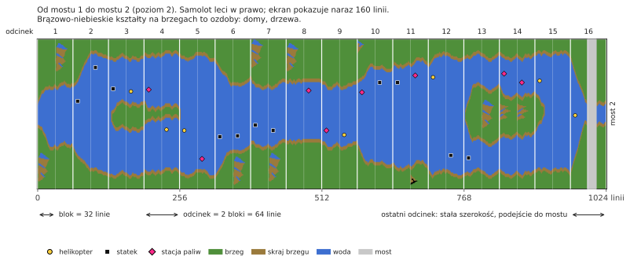

**Poziom** to po prostu numer mostu, do którego lecisz. Utrudnia rzekę: ostrzejsze zakręty, więcej
wrogów, mniej stacji paliw. Na 80 przestaje rosnąć; potem gra przełącza się między poziomami 79 i
80, więc poziomy nieparzyste i parzyste nadal się przeplatają.

## Brzegi

W każdej linii lewy brzeg robi jeden krok: zostaje w miejscu albo przesuwa się o punkt w lewo lub w
prawo (`moveBank`). Czy idzie dalej, staje, czy zawraca, decydują liczby losowe, ale w granicach
zależnych od poziomu: przez pierwsze dwa mosty rzeka ledwo się wije, później przechodzi przez
większość ekranu. Przed krokiem brzeg sprawdza też, czy nie wpadnie na obiekt stawiany właśnie na
górze, więc wrogowie nigdy nie zostają zakopani w brzegu.

Prawy brzeg wynika z lewego: szerokość wody plus szerokość wyspy. Poziomy nieparzyste i parzyste
się różnią:

- **poziomy nieparzyste:** rzeka ma stałą szerokość i wije się szerzej; pod koniec odcinka jest
  ściągana z powrotem ku środkowi ekranu;
- **poziomy parzyste:** każdy odcinek może mieć nową szerokość (`chooseSectionWidth`) i pojawiają
  się wyspy. Wyspa otwiera się przez odcinek o szerokości 0 (rzeka się rozwidla), trwa przez
  chwilę i zamyka się tak samo. Szerokość zmienia się stopniowo, o jeden lub dwa punkty na linię
  (`changeIsland`), więc brzegi tworzą łagodne zbocza.

Na początku niektórych bloków na brzegu stawiana jest **ozdoba**: dom, drzewo, góra
(`startDecoration`). Rysuje się ją linia po linii z małych obrazków zapisanych w kartridżu, po tej
stronie, gdzie jest miejsce.

Każda linia jest w końcu składana z całych bajtów w kolorze brzegu i wody, z krótkimi gotowymi
„kawałkami skraju” tam, gdzie woda styka się z lądem, aby brzeg mógł kończyć się w dowolnym punkcie
(`drawLine`).

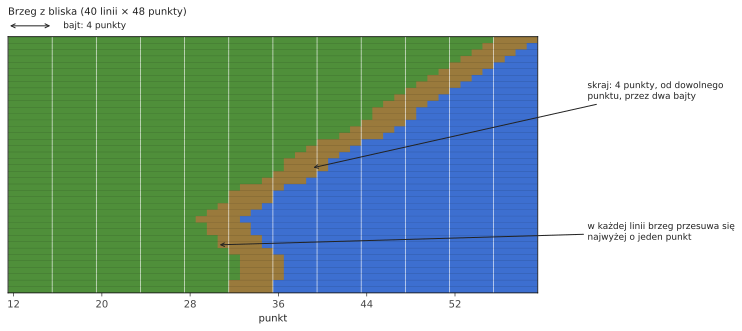

## Wrogowie, paliwo i mosty

Ekran jest podzielony na **11 poziomych pasów** („slotów”); w każdym jest co najwyżej jeden obiekt.
Co 16 linii na górze wchodzi nowy obiekt, do następnego wolnego pasa (`placeObject`):

- na początku bloku: wróg, stacja paliw albo nic. Im wyższy poziom, tym rzadsze stacje (po poziomie
  46 już się nie pogarsza);
- w środku bloku, od poziomu 9: może wróg, tym częściej, im wyższy poziom; od poziomu 40 za każdym
  razem;
- na podejściu do mostu: sam most.

Jaki wróg, decydują liczby losowe (`chooseEnemy`): statek lub helikopter po trzy razy na osiem,
myśliwiec lub balon po razie. Myśliwce pojawiają się dopiero od poziomu 5, balony od poziomu 3 i
tylko na początku bloku; tam, gdzie rzeka jest za wąska, statek zmienia się w helikopter. Od poziomu
13 od czasu do czasu helikopter strzela do ciebie rakietami (tylko jeden taki naraz).

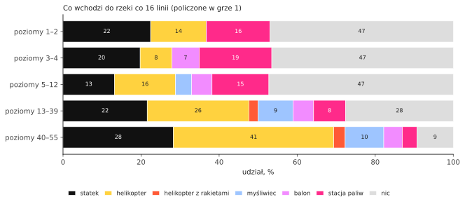

Gdzie w poprzek rzeki stanie obiekt, zależy od poziomu: na poziomach nieparzystych gdziekolwiek,
losowo; na parzystych przy jednym lub drugim brzegu albo obok wyspy (`positionObject`). Patrzy w
stronę od bliższego brzegu.

| obiekt | punkty |
|---|---|
| statek | 30 |
| helikopter | 60 |
| balon | 60 |
| stacja paliw | 80 |
| myśliwiec | 100 |
| helikopter, który strzela | 150 |
| most | 500 |
| most z czołgiem | 750 |

Każde 10 000 punktów daje dodatkowy samolot, do 9.

## Ruch

Na początku obiekty same się nie ruszają: co 16 obrazów losowy pas zostaje „obudzony” (`mainLoop`)
i od tej chwili jego obiekt porusza się w bok. Statki i helikoptery ruszają się co drugi obraz (pasy
nieparzyste i parzyste na zmianę), balony jeszcze o połowę rzadziej, myśliwce w każdym obrazie. Gdy
obiekt dotknie skraju brzegu, raz zawraca. Myśliwce przelatują przez cały ekran i pojawiają się po
drugiej stronie. Przed mostem 2 nic się nie rusza i nic się nie rusza, dopóki nie lecisz.

**Czołgi** jeżdżą po drogach: przez most, a od poziomu 7 po drogach w poprzek brzegów. Czołg na
drodze przy brzegu jedzie do rzeki, zatrzymuje się nad wodą i strzela pociskiem na drugą stronę;
pocisk leci łukiem i wybucha, niszcząc wszystko, na co spadnie, także twój samolot (`driveTank`,
`moveShell`). Od mostu 5 wysadzenie mostu sprawia, że pobliski czołg strzela.

## Dlaczego robi się trudniej

Same liczby losowe niczego nie rozstrzygają: ich ciąg jest taki sam przez całą grę. Zmienia się
to, jak gra je odczytuje. Prawie każda decyzja generatora porównuje liczbę losową (od 0 do 255) z
progiem wyliczonym z poziomu, a progi przesuwają się wraz ze wzrostem poziomu. Te same liczby
losowe, które przy moście 5 dały pusty odcinek, przy moście 25 dają wroga.

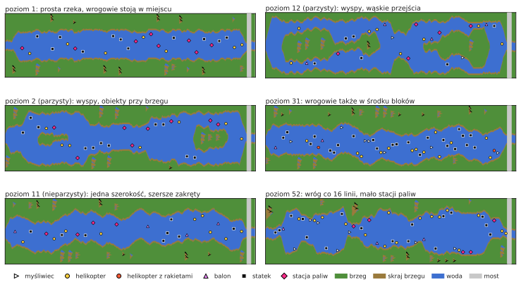

**Wrogowie w środku bloku.** Próg: (poziom − 8) × 8.

| poziom | szansa na wroga |
|---|---|
| do 8 | brak (wrogowie tylko na początku bloku) |
| 10 | 16 na 256, około 6% |
| 20 | 96 na 256, około 38% |
| 30 | 176 na 256, około 69% |
| od 40 | za każdym razem |

**Stacje paliw.** Na początku bloku próg wynosi (63 − poziom) × 2. Powyżej pojawia się wróg;
poniżej w połowie przypadków stacja paliw, a w pozostałych nic. Stacja pojawia się na około 24%
początków bloków na poziomie 1, 17% na poziomie 20 i 6,6% na poziomie 46 (potem nie rzadziej), a
wrogowie rosną tam od około 51% do 87%.

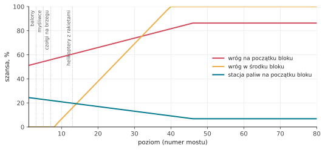

**Nowi wrogowie według poziomu.**

| od poziomu | co się pojawia |
|---|---|
| 3 | balony |
| 5 | myśliwce (wcześniej zamiast nich statek); wysadzony most sprawia, że pobliski czołg strzela |
| 7 | czołgi na drogach przy brzegach |
| 13 | helikoptery strzelające rakietami |

**Jak bardzo wije się rzeka.** Granice, w jakich błądzi brzeg, się poszerzają: na poziomach 1 i 2
rzeka jest prawie prosta (brzeg rusza się w granicach około 8 pozycji); później około 15; na
poziomach nieparzystych od 10 około 39, a od 20 prawie po całym ekranie.

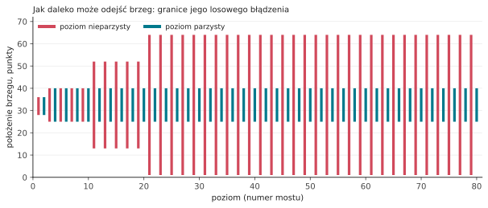

**Zapas przy brzegach.** Poniżej poziomu 9 obiekty trzymają się kilka punktów dalej od brzegów, a
odcinki nigdy nie są bardzo wąskie; poniżej poziomu 20 nie używa się najwęższej szerokości odcinka.

**Ruch.** Przed mostem 2 wrogowie w ogóle się nie ruszają.

Dlatego gry 3–8, zaczynające się przy moście 5, 20 lub 50, zapisują na start dwie rzeczy: stan
generatora przy tym moście, który daje kształt rzeki, i numer poziomu, który daje jej trudność. Bez
poziomu rzeka miałaby ten sam kształt, ale byłaby łatwa.

## Twój samolot

- **Prędkość:** do przodu szybciej, do tyłu wolniej; puść, a wróci do normalnej (`changeSpeed`).
- **Sterowanie:** im dłużej trzymasz drążek w bok, tym szybciej samolot przesuwa się w bok
  (`steer`).
- **Paliwo:** pełny bak starcza na około 34 sekundy. Nad stacją paliw pusty bak napełnia się w około
  2 sekundy; poniżej ćwierci rozlega się ostrzeżenie. Pusty bak to katastrofa.
- **Strzelanie:** jeden pocisk naraz; leci w górę o 6 linii na obraz, aż w coś trafi albo w brzeg.

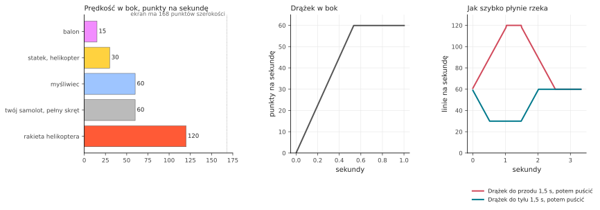

Samolot tracisz, dotykając brzegu, dowolnego wroga lub mostu, od pocisku czołgu lub rakiety
helikoptera albo gdy skończy się paliwo. Rzeka zaczyna się wtedy od nowa od ostatniego mostu (w tym
celu generator pamięta swój stan przy każdym moście: `sectionCheckpoint`, `restoreCheckpoint`);
samolot czeka, aż ruszysz drążkiem. W grze dla dwóch graczy gracze zmieniają się po każdym
straconym samolocie.

## Skąd gra wie, co w co trafiło

Sama rzeka to tylko obraz w pamięci: punkty w czterech kolorach. Wszystko, co porusza się nad nią,
układ graficzny rysuje osobno, na wierzchu obrazu, jako *sprite*. Atari ma ich osiem, a jego
dokumentacja nazywa je **graczami** (players) i **pociskami** (missiles):

- **gracze 0, 1, 2, 3**: cztery sprite'y o szerokości 8 punktów (układ potrafi też rozciągnąć je do
  16 lub 32 punktów: statki rysowane są w podwójnej szerokości, mosty w poczwórnej). Każdy to pas
  wysoki na cały ekran, w swoim kolorze; program mówi, gdzie w poziomie stoi i które z jego 8
  punktów świecą w każdej linii;
- **pociski 0, 1, 2, 3**: kolejne cztery, szerokie tylko na 2 punkty, pomyślane jako kule.

Nazwy pochodzą z gier, dla których układ projektowano: postać każdego gracza była „graczem”, a jej
strzały „pociskami”. Nie mają nic wspólnego z ludźmi grającymi w River Raid, a numery to po prostu
numeracja w układzie. Przesunięcie sprite'a to tylko zmiana jego położenia; obraz rzeki pod nim
pozostaje nietknięty. River Raid używa ich tak:

| sprite | pokazuje |
|---|---|
| gracz 2 | twój samolot |
| pocisk 2 | twój pocisk |
| gracz 1 | czołg na drodze |
| gracz 0 | jego pocisk |
| pocisk 0 | rakietę helikoptera |
| gracz 3 | **wszystkich** wrogów, stacje paliw i mosty |

Jak jeden sprite może pokazać jedenaście obiektów? Podczas rysowania obrazu, linia po linii z góry
na dół, gra przerywa się w wybranych liniach (*przerwanie listy wyświetlania*). W każdym pasie
przenosi gracza 3 do obiektu tego pasa, ustawia mu szerokość i kolory i podaje mu kształt obiektu
linia po linii. Ten sam sprite jest tak używany na całej wysokości ekranu (`display`).

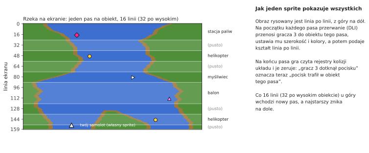

Układ graficzny Atari sam też odnotowuje **kolizje**: gdy w rysowanej linii punkty sprite'a padną na
punkty innego sprite'a albo na kolory brzegu, ustawia bit w rejestrze kolizji. Zaraz po każdym pasie
gra czyta te rejestry i je zeruje. Dzięki temu dokładnie wie, którego pasa, a więc którego obiektu
dotknął pocisk lub samolot, sama nic nie licząc. „Samolot zahaczył o brzeg” to również tylko „gracz
2 nałożył się na kolor brzegu”. Liczy się tylko zieleń: brązowego skraju o szerokości 4 punktów dla
samolotu się nie sprawdza, więc można go musnąć.

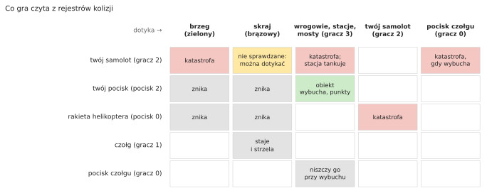

Ponieważ te odczyty odbywają się podczas rysowania obrazu, liczy się dokładna chwila: jeśli pocisk
dotyka obiektu tylko w tej samej linii, w której czytany jest rejestr, to czy się to liczy, zależy
od tego, jak daleko wiązka doszła w tej linii. Port odtwarza to, wykonując kod przerwania z czasem
każdej instrukcji, linia po linii.

## Gdy nikt nie gra

Bez gry program uruchamia **tryb demonstracyjny**: rzeka przepływa bez samolotu, wrogowie się ruszają,
a pasek pod panelem pokazuje autorów i „Press START”. Naciśnięcie klawisza na klawiaturze wstrzymuje
grę, kolejne ją wznawia. Po bardzo długim czasie bez żadnego naciśnięcia (około 73 minut) gra
zatrzymuje się, dopóki coś nie zostanie naciśnięte.

## Dźwięk

Układ dźwiękowy Atari ma cztery głosy; gra ustawia je 60 razy na sekundę (`soundDriver`):

1. silnik, którego wysokość idzie za prędkością, a barwa zmienia się, gdy pchasz lub ciągniesz
   drążek; zastępuje go ostrzeżenie o paliwie, dźwięk tankowania albo katastrofa;
2. wybuchy (szum) i rakieta helikoptera;
3. twoje strzały i fanfara dodatkowego samolotu;
4. gwizd spadającego pocisku czołgu i jego wybuch.
