# Как устроен River Raid

[English](HOW_IT_WORKS.md) | Русский | [Українська](HOW_IT_WORKS.uk.md) | [Deutsch](HOW_IT_WORKS.de.md) | [Polski](HOW_IT_WORKS.pl.md) | [Italiano](HOW_IT_WORKS.it.md) | [Español](HOW_IT_WORKS.es.md) | [中文](HOW_IT_WORKS.zh.md) | [日本語](HOW_IT_WORKS.ja.md)

Это объяснение для всех, кому интересно, без знания программирования: как River Raid для
8-битных Atari (Activision, 1983) строит бесконечную реку, расставляет врагов и мосты и узнаёт,
что во что попало. Всё здесь прочитано из самой программы оригинала и сверено с ней кадр за
кадром (см. [port/README.ru.md](../port/README.ru.md)). Числа приведены такими, какими их использует игра; где это
полезно, в скобках указана соответствующая функция в коде порта. Картинки нарисованы по
генератору реки из порта, своими простыми цветами (`tools/doc_figures.py`).

## Экран

Игра показывает 60 картинок в секунду (на американской машине NTSC, точнее 59,92). Область
реки — 160 строк в высоту и 192 точки в ширину, и каждая точка одного из четырёх цветов: берег
(зелёный), кромка между берегом и водой, вода (синяя) и чёрный там, где ничего нет. Под рекой —
панель: указатель топлива, очки, жизни, счётчик мостов и бегущая строка с логотипом Activision.

Самолёт всегда остаётся внизу экрана. Движется река: время от времени наверху рисуется новая
строка, а всё остальное сдвигается на строку вниз. На обычной скорости это одна строка за
картинку, 60 строк в секунду; ручка вперёд — вдвое быстрее, на себя — вдвое медленнее
(`scrollRiver`). Целиком река нигде не хранится: каждая строка существует только с момента,
когда её нарисовали наверху, до момента, когда она уехала за нижний край.

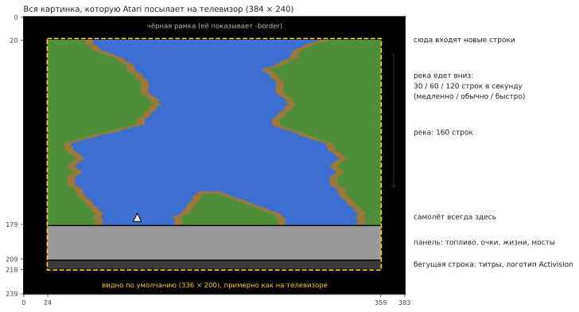

## Река, которая всегда одна и та же

Река в River Raid выглядит случайной, но она одинакова в каждой игре на любой Atari с 1983 года.
Она получается из генератора *псевдослучайных* чисел: 24-битного «сдвигового регистра», который
на каждой строке перемешивается по одному и тому же правилу (`stepLfsr`). Запущенный с одного и
того же значения, он всегда выдаёт одну и ту же последовательность, поэтому одни и те же
повороты, острова и враги появляются в одних и тех же местах. Точки старта игр 1–8 (мост
1, 5, 20 или 50) — это состояния этого регистра и положение берега у этих мостов той же самой реки,
сохранённые, чтобы игре не приходилось прокручивать реку до них.

Параметр порта `-seed N` запускает тот же регистр с другого значения: правила те же, река другая.

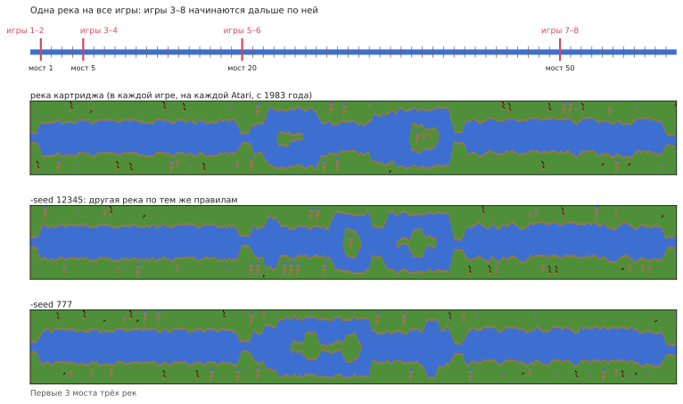

## Блоки, участки и мосты

Река строится из кусков постоянной длины:

```
  блок     = 32 строки
  участок  = 2 блока (64 строки)
  от моста до моста — 16 участков (1 024 строки, около 17 секунд на обычной скорости)
```

В начале каждого блока и участка генератор решает, что будет дальше (`countLines`). Последний
участок перед мостом особый: без острова, постоянной ширины, а его второй блок — прямой подход,
всегда одной и той же формы, который заканчивается мостом с дорогой поперёк берегов. Цвет берега
чередуется между двумя оттенками зелёного от моста к мосту.

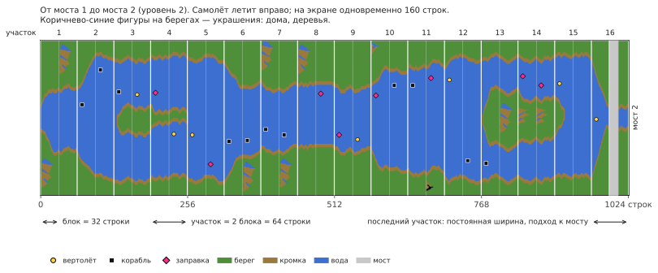

**Уровень** — это просто номер моста, к которому вы летите. Чем он выше, тем река сложнее:
круче повороты, больше врагов, меньше заправок. После 80 он больше не растёт: игра чередует
уровни 79 и 80, чтобы нечётные и чётные уровни продолжали сменять друг друга.

## Берега

На каждой строке левый берег делает шаг: остаётся на месте или сдвигается на точку влево или
вправо (`moveBank`). Продолжать ли, остановиться ли или развернуться, решают случайные числа, но
в пределах, которые зависят от уровня: до второго моста река почти не петляет, дальше мотается
почти по всему экрану. Перед шагом берег проверяет, не врежется ли он в объект, который как раз
ставится наверху, поэтому враги никогда не оказываются внутри берега.

Правый берег получается из левого: ширина воды плюс ширина острова. Нечётные и чётные уровни
отличаются:

- **нечётные уровни:** ширина реки не меняется, зато она сильнее петляет; ближе к концу перегона
  её снова стягивает к середине экрана;
- **чётные уровни:** у каждого участка может быть своя ширина (`chooseSectionWidth`), и
  появляются острова. Остров открывается через участок нулевой ширины (река раздваивается),
  какое-то время держится и закрывается так же. Ширина меняется постепенно, на одну-две точки за
  строку (`changeIsland`), поэтому берега получаются плавными склонами.

В начале некоторых блоков на берег ставится **украшение**: дом, дерево, гора
(`startDecoration`). Оно рисуется строка за строкой из маленьких картинок, хранящихся в
картридже, на той стороне, где хватает места.

Наконец, каждая строка собирается из целых байтов цвета берега и воды, а там, где вода
встречается с землёй, — из коротких готовых «кусочков кромки», чтобы берег мог заканчиваться на
любой точке (`drawLine`).

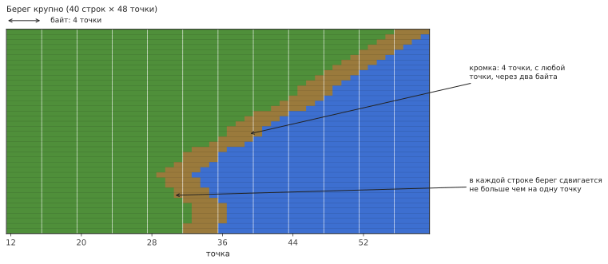

## Враги, заправки и мосты

Экран поделён на **11 горизонтальных полос** («слотов»), в каждой не больше одного объекта.
Каждые 16 строк наверху в следующей свободной полосе появляется новый объект (`placeObject`):

- в начале блока — враг, заправка или ничего. Чем выше уровень, тем реже заправки (после 46-го
  хуже не становится);
- в середине блока, начиная с 9-го уровня, — может быть враг, тем чаще, чем выше уровень; с
  40-го — каждый раз;
- на подходе к мосту — сам мост.

Какой будет враг, решают случайные числа (`chooseEnemy`): корабль или вертолёт — по три раза из
восьми, реактивный самолёт или воздушный шар — по разу. Самолёты бывают с 5-го уровня, шары с
3-го и только в начале блока; там, где река слишком узкая, корабль заменяется вертолётом. С
13-го уровня иногда попадается вертолёт, который стреляет в вас ракетами (такой бывает только
один за раз).

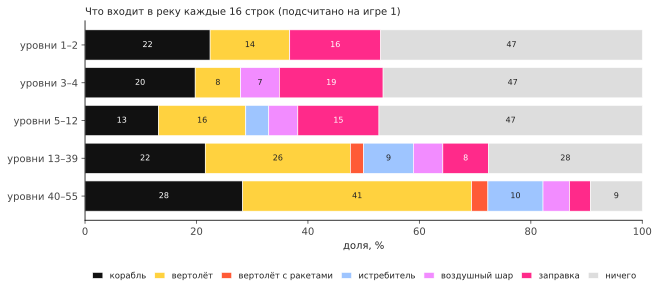

Где поперёк реки окажется объект, зависит от уровня: на нечётных — где угодно, случайно; на
чётных — у одного или другого берега или рядом с островом (`positionObject`). Смотрит он в
сторону от ближнего берега.

| объект | очки |
|---|---|
| корабль | 30 |
| вертолёт | 60 |
| воздушный шар | 60 |
| заправка | 80 |
| реактивный самолёт | 100 |
| стреляющий вертолёт | 150 |
| мост | 500 |
| мост с танком на нём | 750 |

Каждые 10 000 очков дают ещё один самолёт, всего до 9.

## Движение

Поначалу объекты стоят на месте: каждые 16 картинок одна случайная полоса «просыпается»
(`mainLoop`), и с этого момента её объект движется вбок. Корабли и вертолёты сдвигаются через
картинку (чётные и нечётные полосы по очереди), шары ещё вдвое реже, самолёты — на каждой
картинке. Коснувшись кромки берега, объект один раз разворачивается. Самолёты пролетают
насквозь и появляются с другой стороны экрана. До второго моста ничего не движется, и ничего не
движется, пока вы не летите.

**Танки** ездят по дорогам: по мосту, а с 7-го уровня — и по дорогам поперёк берегов. Танк на
береговой дороге едет к реке, останавливается у воды и стреляет через неё; снаряд летит по дуге
и взрывается, уничтожая то, на что упал, в том числе ваш самолёт (`driveTank`, `moveShell`). С
5-го моста взрыв моста заставляет стрелять танк, стоящий рядом.

## Почему становится сложнее

Сами случайные числа ничего не решают: их последовательность одна и та же всю игру. Меняется
то, как игра их толкует. Почти каждое решение генератора сравнивает случайное число (от 0 до
255) с порогом, вычисленным из уровня, и с ростом уровня пороги сдвигаются. Те же случайные
числа, которые у 5-го моста дали пустой отрезок, у 25-го дают врага.

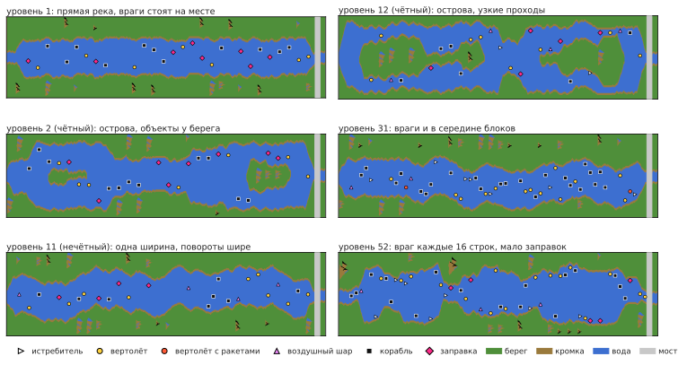

**Враги посреди блока.** Порог: (уровень − 8) × 8.

| уровень | вероятность врага |
|---|---|
| до 8 | нет (враги только в начале блоков) |
| 10 | 16 из 256, около 6% |
| 20 | 96 из 256, около 38% |
| 30 | 176 из 256, около 69% |
| 40 и выше | всегда |

**Заправки.** В начале блока порог (63 − уровень) × 2. Выше него — враг; ниже — в половине
случаев заправка, иначе пусто. Заправка выпадает примерно в 24% начал блоков на 1-м уровне, в
17% на 20-м и в 6,6% на 46-м (дальше реже не становится), а враги там — от 51% до 87%.

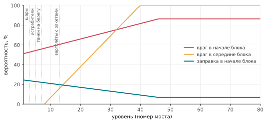

**Новые враги по уровням.**

| с уровня | что появляется |
|---|---|
| 3 | воздушные шары |
| 5 | реактивные самолёты (до этого вместо них корабль); взорванный мост заставляет стрелять танк рядом |
| 7 | танки на береговых дорогах |
| 13 | вертолёты, которые стреляют ракетами |

**Насколько петляет река.** Пределы, в которых гуляет берег, расширяются: на 1-м и 2-м уровнях
река почти прямая (берег ходит в пределах примерно 8 позиций); дальше — около 15; на нечётных
уровнях с 10-го — около 39, а с 20-го — почти по всему экрану.

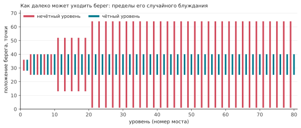

**Запас у берегов.** Ниже 9-го уровня объекты держатся на несколько точек дальше от берегов, а
участки не бывают очень узкими; ниже 20-го самая узкая ширина участка не используется.

**Движение.** До второго моста враги вообще не двигаются.

Поэтому игры 3–8, которые начинаются с моста 5, 20 или 50, хранят для старта две вещи:
состояние генератора у этого моста, от которого зависит форма реки, и номер уровня, от которого
зависит её сложность. Без номера уровня река была бы той же формы, но лёгкой.

## Ваш самолёт

- **Скорость:** вперёд — быстрее, на себя — медленнее; отпустили — возвращается к обычной
  (`changeSpeed`).
- **Поворот:** чем дольше держите ручку вбок, тем быстрее самолёт смещается (`steer`).
- **Топливо:** полного бака хватает примерно на 34 секунды. Над заправкой пустой бак наполняется
  примерно за 2 секунды; ниже четверти звучит предупреждение. Пустой бак — это авария.
- **Стрельба:** одна пуля за раз; она летит вверх по 6 строк за картинку, пока во что-нибудь не
  попадёт или не упрётся в берег.

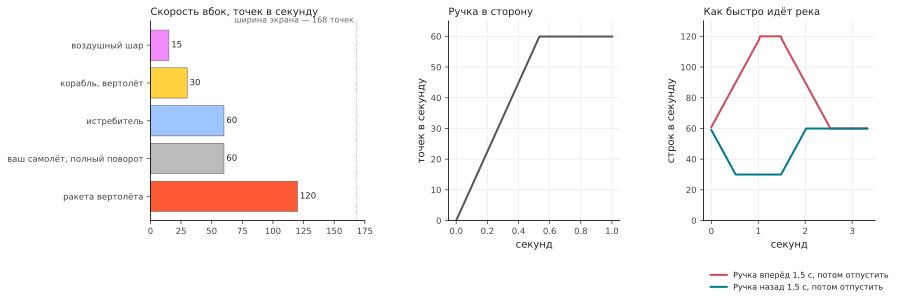

Самолёт теряется, если коснуться берега, любого врага или моста, попасть под снаряд танка или
ракету вертолёта или остаться без топлива. Тогда река начинается заново от последнего моста (для
этого генератор запоминает своё состояние у каждого моста: `sectionCheckpoint`,
`restoreCheckpoint`), а самолёт ждёт, пока вы не тронете ручку. В игре на двоих после каждого
потерянного самолёта игроки сменяются.

## Как игра узнаёт, что во что попало

Сама река — это просто картинка в памяти: точки четырёх цветов. Всё, что движется поверх неё,
видеочип рисует отдельно, поверх картинки, как *спрайт*. Таких у Atari восемь, и в её
документации они называются **игроками** (players) и **ракетами** (missiles):

- **игроки 0, 1, 2, 3** — четыре спрайта шириной 8 точек (чип умеет растягивать их до 16 или 32
  точек: корабли рисуются двойной ширины, мосты — четверной). Каждый — это полоса высотой во весь
  экран со своим цветом; программа говорит, где по горизонтали она стоит и какие из 8 точек
  горят в каждой строке;
- **ракеты 0, 1, 2, 3** — ещё четыре, шириной всего 2 точки, задуманные для пуль.

Названия пошли от игр, для которых чип придумывали: фигурка каждого игрока была «игроком», а её
выстрелы — «ракетами». К людям, которые играют в River Raid, они отношения не имеют, а номера —
просто нумерация в чипе. Чтобы сдвинуть спрайт, достаточно поменять его положение, картинка реки
под ним не трогается. River Raid распределяет их так:

| спрайт | показывает |
|---|---|
| игрок 2 | ваш самолёт |
| ракета 2 | вашу пулю |
| игрок 1 | танк на дороге |
| игрок 0 | его снаряд |
| ракета 0 | ракету вертолёта |
| игрок 3 | **всех** врагов, заправки и мосты |

Как один спрайт показывает одиннадцать объектов? Пока картинка рисуется строка за строкой
сверху вниз, игра прерывает сама себя на нужных строках (*прерывание списка отображения*). В
каждой полосе она переносит игрока 3 к объекту этой полосы, задаёт ему ширину и цвета и строка за
строкой подаёт ему форму объекта. Так один и тот же спрайт используется по всей высоте экрана
(`display`).

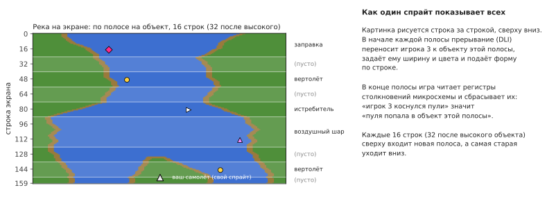

А **столкновения** видеочип Atari отмечает сам: если на рисуемой строке точки спрайта попадают на
точки другого спрайта или на цвета берега, он ставит бит в регистре столкновений. Сразу после
каждой полосы игра читает эти регистры и сбрасывает их. Так она точно знает, какой полосы, а
значит, какого объекта коснулась пуля или самолёт, — ничего не вычисляя сама. «Самолёт задел
берег» — это тоже просто «игрок 2 наложился на цвет берега». Считается только зелёный: коричневую
кромку шириной 4 точки для самолёта не проверяют, так что её можно задеть.

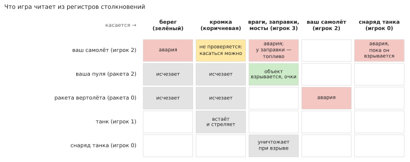

Поскольку чтение происходит во время рисования картинки, важен точный момент: если пуля задевает
объект только на той самой строке, где читается регистр, засчитается ли это, зависит от того,
как далеко по строке успел пройти луч. Порт воспроизводит это, выполняя код прерывания с тем
временем, которое занимает каждая команда, строка за строкой.

## Когда никто не играет

Без игры программа показывает **демо-режим**: река едет сама, без самолёта, враги двигаются, а
бегущая строка под панелью показывает авторов и «Press START». Нажатие любой клавиши клавиатуры
ставит игру на паузу, повторное — продолжает. После очень долгого времени без нажатий (около 73
минут) игра замирает, пока что-нибудь не нажмут.

## Звук

У звукового чипа Atari четыре голоса; игра задаёт их 60 раз в секунду (`soundDriver`):

1. двигатель: высота тона следует за скоростью, а тембр меняется, когда вы толкаете или тянете
   ручку; его сменяют предупреждение о топливе, звук заправки или авария;
2. взрывы (шум) и ракета вертолёта;
3. ваши выстрелы и фанфары за новый самолёт;
4. свист падающего снаряда танка и его взрыв.
