# Як влаштований River Raid

[English](HOW_IT_WORKS.md) | [Русский](HOW_IT_WORKS.ru.md) | Українська | [Deutsch](HOW_IT_WORKS.de.md) | [Polski](HOW_IT_WORKS.pl.md) | [Italiano](HOW_IT_WORKS.it.md) | [Español](HOW_IT_WORKS.es.md) | [中文](HOW_IT_WORKS.zh.md) | [日本語](HOW_IT_WORKS.ja.md)

Це пояснення для всіх, кому цікаво, без знання програмування: як River Raid для 8-бітних Atari
(Activision, 1983) будує нескінченну річку, розставляє ворогів і мости та дізнається, що у що
влучило. Усе тут прочитано з самої програми оригіналу й звірено з нею кадр за кадром (див.
`port/README.uk.md`). Числа наведено такими, якими їх використовує гра; де це корисно, у дужках
указано відповідну функцію в коді порту. Картинки намальовано за генератором річки з порту,
своїми простими кольорами (`tools/doc_figures.py`).

## Екран

Гра показує 60 картинок за секунду (на американській машині NTSC; точніше, 59,92). Ділянка
річки має висоту 160 рядків і ширину 192 точки, і кожна точка — одного з чотирьох кольорів:
берег (зелений), кромка між берегом і водою, вода (синя) і чорний там, де нічого не намальовано.
Під нею — панель: покажчик пального, очки, життя, лічильник мостів і рядок, що біжить, з логотипом
Activision.

Літак завжди лишається внизу екрана. Рухається річка: раз у раз нагорі малюється новий рядок, а
все інше зсувається на рядок униз. На звичайній швидкості це один рядок за картинку, 60 рядків
за секунду; ручка вперед — удвічі швидше, на себе — удвічі повільніше (`scrollRiver`). Цілої
річки ніде не зберігається: кожен рядок існує лише від моменту, коли його намалювали нагорі, до
моменту, коли він поїхав за нижній край.

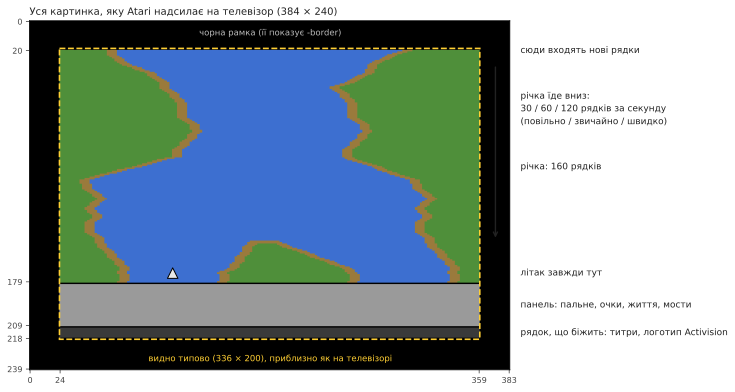

## Річка, яка завжди та сама

Річка River Raid виглядає випадковою, але однакова в кожній грі, на кожній Atari, з 1983 року.
Її дає генератор *псевдовипадкових* чисел: 24-бітний «зсувний регістр», який на кожному рядку
перемішується за сталим правилом (`stepLfsr`). Запущений з того самого значення, він завжди дає
ту саму послідовність чисел, тож ті самі повороти, острови й вороги з'являються в тих самих
місцях. Точки старту ігор 1–8 (міст 1, 5, 20 або 50) — це стани цього регістра й положення берега
біля цих мостів тієї самої річки, збережені, щоб грі не доводилося прокручувати річку до них.

Параметр порту `-seed N` запускає той самий регістр з іншого значення: правила ті самі, річка інша.

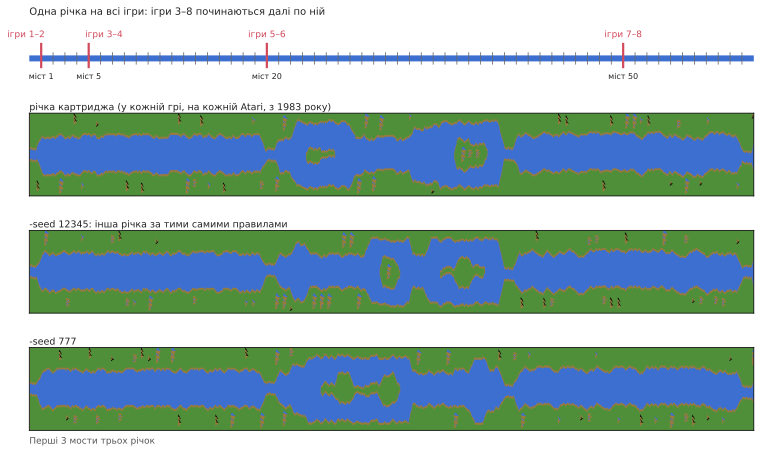

## Блоки, ділянки й мости

Річка будується зі шматків сталої довжини:

```
  блок     = 32 рядки
  ділянка  = 2 блоки (64 рядки)
  16 ділянок від мосту до мосту (1 024 рядки, близько 17 секунд на звичайній швидкості)
```

На початку кожного блоку й ділянки генератор вирішує, що буде далі (`countLines`). Остання ділянка
перед мостом особлива: без острова, сталої ширини, а її другий блок — прямий підхід, завжди тієї
самої форми, який закінчується мостом із дорогою впоперек берегів. Колір берега чергується між
двома відтінками зеленого від мосту до мосту.

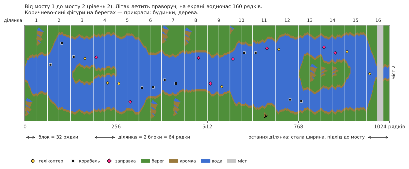

**Рівень** — це просто номер мосту, до якого ви летите. Що він вищий, то річка складніша: крутіші
повороти, більше ворогів, менше заправок. Після 80 він більше не росте: гра чергує рівні 79 і 80,
тож непарні й парні рівні так і йдуть по черзі.

## Береги

На кожному рядку лівий берег робить один крок: лишається на місці або зсувається на точку ліворуч
чи праворуч (`moveBank`). Чи йти далі, зупинитися чи повернути, вирішують випадкові числа, але в
межах, що залежать від рівня: перші два мости річка ледь звивається, далі ходить майже по всьому
екрану. Перед кроком берег ще перевіряє, що не наскочить на об'єкт, який ставиться нагорі, тож
вороги ніколи не опиняються в березі.

Правий берег виходить з лівого: ширина води плюс ширина острова. Непарні й парні рівні різняться:

- **непарні рівні:** річка зберігає ту саму ширину й звивається ширше; під кінець відрізка її
  тягне назад до середини екрана;
- **парні рівні:** кожна ділянка може мати нову ширину (`chooseSectionWidth`), і з'являються
  острови. Острів відкривається через ділянку шириною 0 (річка розходиться), тримається якийсь час
  і закривається так само. Ширина змінюється поступово, на одну-дві точки за рядок
  (`changeIsland`), тому береги виходять плавними схилами.

На початку деяких блоків на берег ставиться **прикраса**: будинок, дерево, гора
(`startDecoration`). Вона малюється рядок за рядком з маленьких картинок, що зберігаються в
картриджі, на тому боці, де вистачає місця.

Нарешті, кожен рядок складається з цілих байтів кольору берега й води, а там, де вода стикається
з землею, — з коротких готових «шматочків кромки», щоб берег міг закінчуватися на будь-якій точці
(`drawLine`).

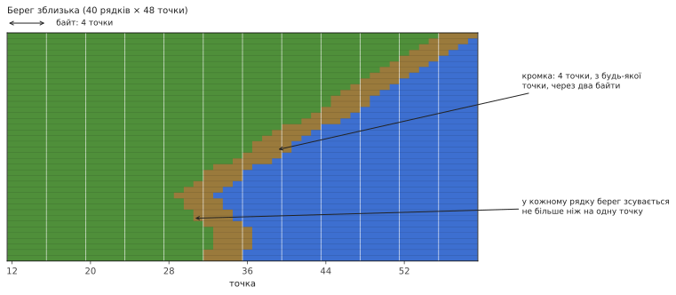

## Вороги, заправки й мости

Екран поділено на **11 горизонтальних смуг** («слотів»); у кожній — щонайбільше один об'єкт.
Кожні 16 рядків нагорі входить новий об'єкт, у наступну вільну смугу (`placeObject`):

- на початку блоку: ворог, або заправка, або нічого. Що вищий рівень, то рідше заправки (після
  46-го рівня гірше не стає);
- посеред блоку, з 9-го рівня: можливо, ворог, і то частіше, що вищий рівень; з 40-го — щоразу;
- на підході до мосту: сам міст.

Який ворог — вирішують випадкові числа (`chooseEnemy`): корабель або гелікоптер — по три рази з
восьми, винищувач або повітряна куля — по разу. Винищувачі бувають з 5-го рівня, кулі з 3-го і
лише на початку блоку; там, де річка завузька, корабель замінюється гелікоптером. З 13-го рівня
часом трапляється гелікоптер, який стріляє у вас ракетами (такий буває лише один за раз).

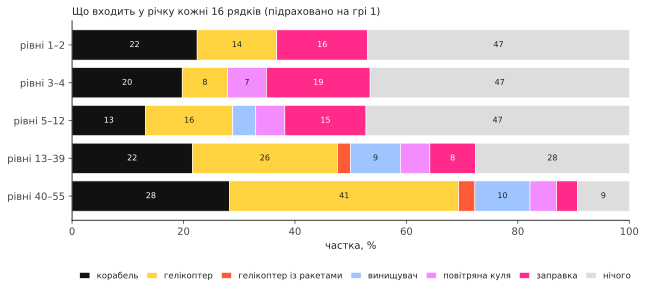

Де впоперек річки стане об'єкт, залежить від рівня: на непарних — будь-де, навмання; на парних —
біля того чи іншого берега або біля острова (`positionObject`). Він дивиться від ближчого берега.

| об'єкт | очки |
|---|---|
| корабель | 30 |
| гелікоптер | 60 |
| повітряна куля | 60 |
| заправка | 80 |
| винищувач | 100 |
| гелікоптер, що стріляє | 150 |
| міст | 500 |
| міст із танком | 750 |

Кожні 10 000 очок дають додатковий літак, до 9.

## Рух

Спочатку об'єкти самі не рухаються: кожні 16 картинок випадкова смуга «прокидається»
(`mainLoop`), і відтоді її об'єкт рухається вбік. Кораблі й гелікоптери зсуваються через
картинку (непарні й парні смуги по черзі), кулі — ще вдвічі рідше, винищувачі — щокартинки.
Торкнувшись кромки берега, об'єкт один раз розвертається. Винищувачі пролітають екран наскрізь і
з'являються з іншого боку. До мосту 2 нічого не рухається, і нічого не рухається, поки ви не
летите.

**Танки** їздять дорогами: через міст, а з 7-го рівня — дорогами впоперек берегів. Танк на
береговій дорозі їде до річки, зупиняється біля води й стріляє снарядом через неї; снаряд летить
дугою й вибухає, знищуючи все, на що впаде, зокрема ваш літак (`driveTank`, `moveShell`). З 5-го
мосту підірваний міст змушує сусідній танк стріляти.

## Чому стає складніше

Самі випадкові числа нічого не вирішують: їхня послідовність та сама всю гру. Змінюється те, як
гра їх тлумачить. Майже кожне рішення генератора порівнює випадкове число (від 0 до 255) з
порогом, обчисленим з рівня, і з ростом рівня пороги зсуваються. Ті самі випадкові числа, що біля
5-го мосту дали порожній відрізок, біля 25-го дають ворога.

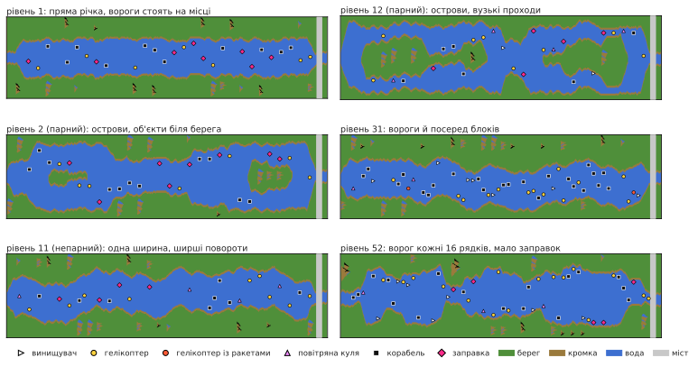

**Вороги посеред блоку.** Поріг: (рівень − 8) × 8.

| рівень | імовірність ворога |
|---|---|
| до 8 | жодної (вороги лише на початку блоку) |
| 10 | 16 з 256, близько 6% |
| 20 | 96 з 256, близько 38% |
| 30 | 176 з 256, близько 69% |
| 40 і вище | щоразу |

**Заправки.** На початку блоку поріг — (63 − рівень) × 2. Вище за нього — ворог; нижче — у
половині випадків заправка, інакше нічого. Заправка трапляється приблизно на 24% початків блоків
на 1-му рівні, 17% на 20-му і 6,6% на 46-му (далі не рідше), а вороги там — від приблизно 51% до
87%.

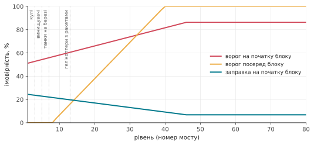

**Нові вороги за рівнями.**

| з рівня | що з'являється |
|---|---|
| 3 | повітряні кулі |
| 5 | винищувачі (до того замість них корабель); підірваний міст змушує сусідній танк стріляти |
| 7 | танки на берегових дорогах |
| 13 | гелікоптери, що стріляють ракетами |

**Наскільки петляє річка.** Межі, у яких блукає берег, ширшають: на 1-му і 2-му рівнях річка
майже пряма (берег ходить у межах приблизно 8 позицій); далі — близько 15; на непарних рівнях з
10-го — близько 39, а з 20-го — майже по всьому екрану.

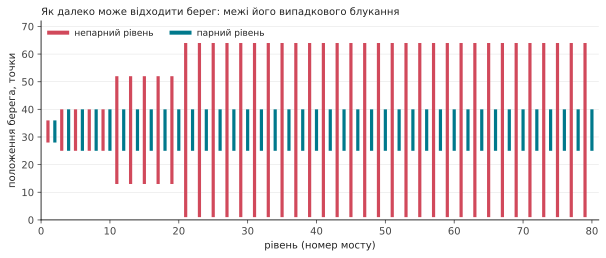

**Запас біля берегів.** Нижче 9-го рівня об'єкти тримаються на кілька точок далі від берегів, а
ділянки ніколи не бувають дуже вузькими; нижче 20-го найвужча ширина ділянки не використовується.

**Рух.** До мосту 2 вороги взагалі не рухаються.

Тому ігри 3–8, що починаються з мосту 5, 20 або 50, зберігають для старту дві речі: стан
генератора біля цього мосту, від якого залежить форма річки, і номер рівня, від якого залежить її
складність. Без номера рівня річка була б тієї самої форми, але легкою.

## Ваш літак

- **Швидкість:** уперед — швидше, на себе — повільніше; відпустили — повертається до звичайної
  (`changeSpeed`).
- **Поворот:** що довше тримаєте ручку вбік, то швидше літак зсувається (`steer`).
- **Пальне:** повного бака вистачає приблизно на 34 секунди. Над заправкою порожній бак
  наповнюється приблизно за 2 секунди; нижче чверті звучить попередження. Порожній бак — аварія.
- **Стрільба:** одна куля за раз; вона летить угору по 6 рядків за картинку, доки в щось не
  влучить або не впреться в берег.

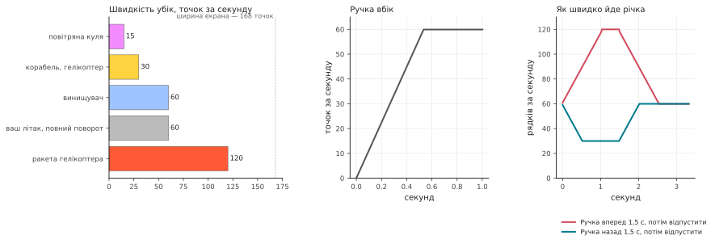

Літак втрачається, якщо торкнутися берега, будь-якого ворога чи мосту, потрапити під снаряд танка
чи ракету гелікоптера або залишитися без пального. Тоді річка починається знову від останнього
мосту (для цього генератор пам'ятає свій стан біля кожного мосту: `sectionCheckpoint`,
`restoreCheckpoint`); літак чекає, доки ви не зрушите ручку. У грі на двох гравці ходять по черзі
після кожного втраченого літака.

## Як гра дізнається, що у що влучило

Сама річка — це просто картинка в пам'яті: точки чотирьох кольорів. Усе, що рухається поверх неї,
відеочип малює окремо, поверх картинки, як *спрайт*. Таких в Atari вісім, і в її документації
вони називаються **гравцями** (players) і **ракетами** (missiles):

- **гравці 0, 1, 2, 3** — чотири спрайти шириною 8 точок (чип уміє розтягувати їх до 16 або 32
  точок: кораблі малюються подвійної ширини, мости — четверної). Кожен — це смуга заввишки з
  увесь екран зі своїм кольором; програма каже, де по горизонталі вона стоїть і які з 8 точок
  світяться в кожному рядку;
- **ракети 0, 1, 2, 3** — ще чотири, шириною всього 2 точки, задумані для куль.

Назви пішли від ігор, для яких чип вигадували: фігурка кожного гравця була «гравцем», а її
постріли — «ракетами». До людей, які грають у River Raid, вони стосунку не мають, а номери — просто
нумерація в чипі. Щоб зсунути спрайт, досить змінити його положення, картинка річки під ним не
чіпається. River Raid розподіляє їх так:

| спрайт | показує |
|---|---|
| гравець 2 | ваш літак |
| ракета 2 | вашу кулю |
| гравець 1 | танк на дорозі |
| гравець 0 | його снаряд |
| ракета 0 | ракету гелікоптера |
| гравець 3 | **усіх** ворогів, заправки й мости |

Як один спрайт показує одинадцять об'єктів? Поки картинка малюється рядок за рядком згори вниз,
гра перериває сама себе на потрібних рядках (*переривання списку відображення*). У кожній смузі
вона переносить гравця 3 до об'єкта цієї смуги, задає йому ширину й кольори і рядок за рядком
подає йому форму об'єкта. Так один і той самий спрайт використовується по всій висоті екрана
(`display`).

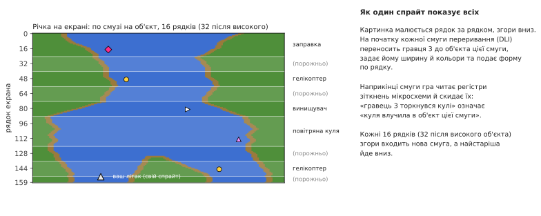

А **зіткнення** відеочип Atari відзначає сам: якщо на рядку, що малюється, точки спрайта
потрапляють на точки іншого спрайта чи на кольори берега, він ставить біт у регістрі зіткнень.
Одразу після кожної смуги гра читає ці регістри й скидає їх. Тож вона точно знає, якої смуги, а
отже, якого об'єкта торкнулася куля чи літак, нічого не обчислюючи сама. «Літак зачепив берег» —
це теж просто «гравець 2 наклався на колір берега». Рахується лише зелений: коричневу кромку
шириною 4 точки для літака не перевіряють, тож її можна зачепити.

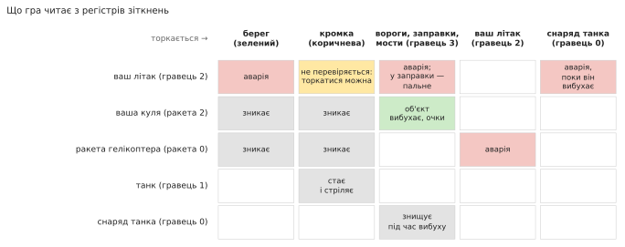

Оскільки ці читання відбуваються під час малювання картинки, важить точний момент: якщо куля
торкається об'єкта лише на тому самому рядку, де читається регістр, чи зарахується це, залежить
від того, як далеко промінь пройшов цим рядком. Порт відтворює це, виконуючи код переривання з
урахуванням часу кожної інструкції, рядок за рядком.

## Коли ніхто не грає

Без гри програма крутить **демонстраційний режим**: річка пропливає без літака, вороги рухаються,
а рядок під панеллю показує титри й «Press START». Натискання клавіші клавіатури ставить гру на
паузу, ще одне — продовжує. Після дуже довгого часу без жодного натискання (близько 73 хвилин) гра
завмирає, доки щось не натиснуть.

## Звук

Звуковий чип Atari має чотири голоси; гра налаштовує їх 60 разів за секунду (`soundDriver`):

1. двигун, висота якого йде за швидкістю, а тембр змінюється, коли штовхаєте чи тягнете ручку;
   його замінюють попередження про пальне, звук заправки або аварія;
2. вибухи (шум) і ракета гелікоптера;
3. ваші постріли й фанфари додаткового літака;
4. свист снаряда танка, що падає, і його вибух.
