# River Raid 是如何运作的

[English](HOW_IT_WORKS.md) | [Русский](HOW_IT_WORKS.ru.md) | [Українська](HOW_IT_WORKS.uk.md) | [Deutsch](HOW_IT_WORKS.de.md) | [Polski](HOW_IT_WORKS.pl.md) | [Italiano](HOW_IT_WORKS.it.md) | [Español](HOW_IT_WORKS.es.md) | 中文 | [日本語](HOW_IT_WORKS.ja.md)

这是一篇写给所有好奇者的说明，不需要编程知识：8 位 Atari 版 River Raid（Activision，1983）如何构造无尽的河，如何摆放敌人和桥，又如何知道什么撞上了什么。这里的一切都读自原版程序，并与它逐帧对照过（见 [port/README.zh.md](../port/README.zh.md)）。数字按游戏实际使用的样子给出；在有帮助的地方，括号里写的是移植代码中对应函数的名字。图片用移植版的河流生成器绘制，配色是自己的简单颜色（`tools/doc_figures.py`）。

## 屏幕

游戏每秒显示 60 幅画面（在美国的 NTSC 机器上；准确说是 59.92）。河的区域高 160 行、宽 192 点，每个点是四种颜色之一：河岸（绿色）、河岸与水之间的岸边、水（蓝色），以及什么都没画处的黑色。下面是状态栏：燃料表、分数、生命、桥计数，以及一行带 Activision 标志的滚动字幕。

飞机始终停在屏幕下部。移动的是河：每隔一会儿，顶部画出新的一行，其余所有内容下移一行。正常速度下是每幅画面一行，即每秒 60 行；把摇杆向前推速度加倍，向后拉速度减半（`scrollRiver`）。整条河从未被存储在任何地方：每一行只从它在顶部被画出的那一刻存在，直到它滚出屏幕底部。

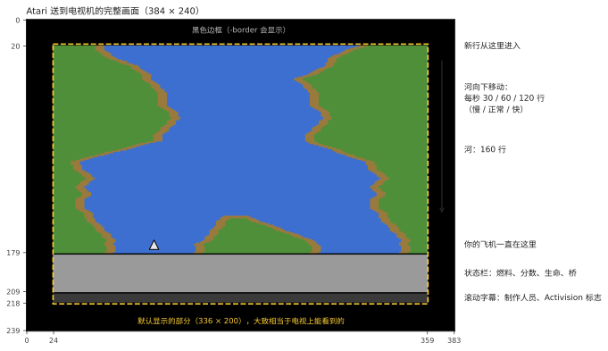

## 一条永远不变的河

River Raid 的河看似随机，但自 1983 年起在每一局、每台 Atari 上都完全相同。它来自一个*伪随机*数生成器：一个 24 位的“移位寄存器”，每一行按固定规则搅动一次（`stepLfsr`）。从同一个值开始，它总是产生同样的数列，所以同样的弯道、岛屿和敌人出现在同样的位置。游戏 1–8 的起点（第 1、5、20 或 50 座桥）就是同一条河在这些桥处该寄存器的状态以及河岸位置，事先存好，这样游戏就不必把河一路跑到那里。

移植版的 `-seed N` 参数让同一个寄存器从另一个值开始：规则不变，河换了一条。

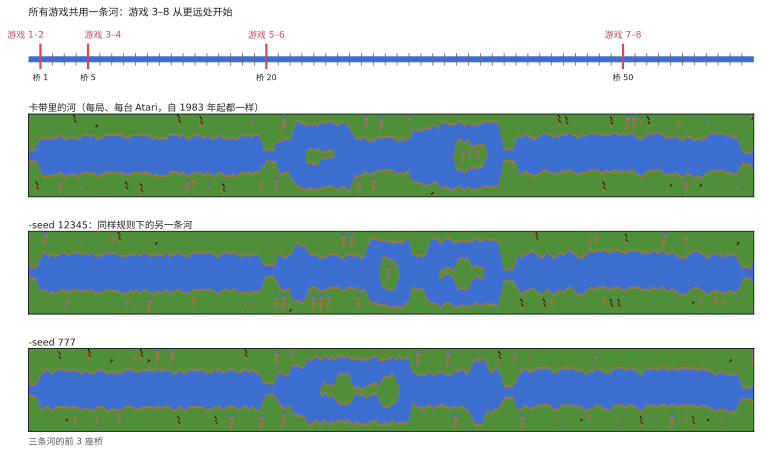

## 块、段和桥

河由固定长度的片段构成：

```
  块  = 32 行
  段  = 2 块（64 行）
  两座桥之间 16 段（1 024 行，正常速度下约 17 秒）
```

在每个块和段的开头，生成器决定接下来是什么（`countLines`）。桥前的最后一段很特殊：没有岛，宽度固定，它的第二块是一段笔直的引道，形状总是一样，以一座横跨两岸、带公路的桥结束。河岸颜色每过一座桥在两种绿色之间交替。

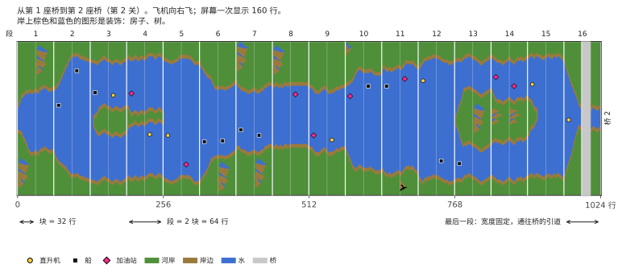

**关卡**就是你正飞向的那座桥的编号。关卡越高，河越难：弯更急，敌人更多，加油站更少。到 80 就不再增长；此后游戏在 79 和 80 两关之间交替，所以奇数关和偶数关仍然轮流出现。

## 河岸

每一行，左岸走一步：留在原地，或者向左或向右移动一个点（`moveBank`）。继续走、停下还是掉头，由随机数决定，但限制在取决于关卡的范围内：在前两座桥，河几乎不弯，之后会摆过屏幕的大部分。迈步之前，河岸还会检查自己不会撞上正在顶部放置的物体，所以敌人永远不会被埋进河岸。

右岸由左岸推出：水宽加岛宽。奇数关和偶数关不同：

- **奇数关：**河保持同样的宽度，弯得更大；接近这一段的末尾时会被拉回屏幕中央；
- **偶数关：**每一段都可以有新的宽度（`chooseSectionWidth`），并且会出现岛。岛通过一段宽度为 0 的段打开（河分叉），持续一阵，再以同样方式合上。宽度是逐渐变化的，每行一到两个点（`changeIsland`），所以河岸形成平缓的斜坡。

在某些块的开头，河岸上会放一个**装饰**：房子、树、山（`startDecoration`）。它由卡带里存的小图一行一行画出，画在有空间的那一侧。

最后，每一行由河岸色和水色的整字节拼成，在水与陆地相接处使用现成的短“岸边片段”，这样岸线可以停在任意一个点上（`drawLine`）。

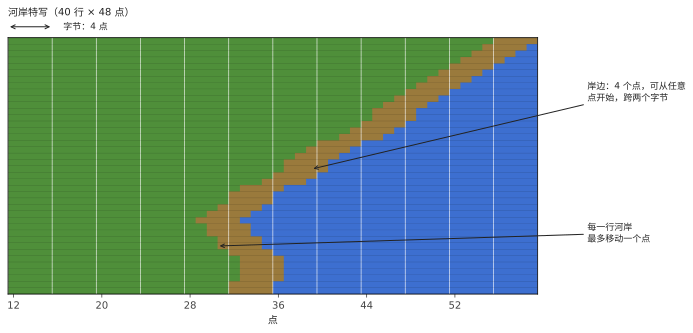

## 敌人、燃料和桥

屏幕被分成 **11 条横带**（“槽位”）；每条最多容纳一个物体。每 16 行，就有一个新物体从顶部进入下一条空闲的带（`placeObject`）：

- 在块的开头：一个敌人、一个加油站，或者什么都没有。关卡越高，加油站越少（46 关之后不再变得更少）；
- 在块的中间，从第 9 关起：可能有一个敌人，关卡越高越频繁；从第 40 关起每次都有；
- 在桥的引道上：桥本身。

是哪种敌人由随机数决定（`chooseEnemy`）：船或直升机各占八分之三，喷气战机或热气球各占八分之一。喷气战机从第 5 关才出现，热气球从第 3 关起且只出现在块的开头；河太窄的地方，船会变成直升机。从第 13 关起，偶尔会有一架直升机向你发射导弹（同一时间只有一架）。

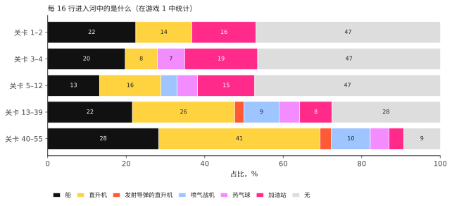

物体在河的横向位置取决于关卡：奇数关随机放在任何地方；偶数关放在某一侧河岸旁或岛旁（`positionObject`）。它朝向远离较近河岸的方向。

| 物体 | 分数 |
|---|---|
| 船 | 30 |
| 直升机 | 60 |
| 热气球 | 60 |
| 加油站 | 80 |
| 喷气战机 | 100 |
| 会开火的直升机 | 150 |
| 桥 | 500 |
| 桥上有坦克 | 750 |

每 10 000 分奖励一架飞机，最多 9 架。

## 移动

一开始物体不会自己移动：每 16 幅画面随机“唤醒”一条带（`mainLoop`），从此它的物体横向移动。船和直升机每两幅画面移动一次（奇数带和偶数带轮流），热气球再慢一半，喷气战机每幅画面都动。物体碰到岸边时会掉头一次。喷气战机会横穿整个屏幕，从另一侧重新出现。第 2 座桥之前什么都不动，你没在飞的时候也什么都不动。

**坦克**在公路上行驶：横穿桥面，以及从第 7 关起横穿河岸的公路。河岸公路上的坦克开向河边，停在水边，向对岸发射一枚炮弹；炮弹沿弧线飞行后爆炸，摧毁落点处的一切，包括你的飞机（`driveTank`、`moveShell`）。从第 5 座桥起，炸掉一座桥会让附近的坦克开火。

## 为什么越来越难

随机数本身什么也不决定：整局游戏中数列都是同一个。改变的是游戏如何解读它们。生成器的几乎每个决定都把一个随机数（0 到 255）与一个由关卡算出的阈值比较，而阈值随关卡升高而移动。同样的随机数，在第 5 座桥处给出空的一段，在第 25 座桥处就给出一个敌人。

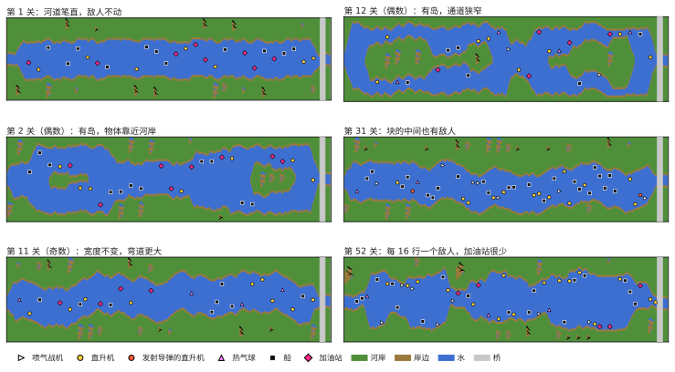

**块中间的敌人。**阈值：（关卡 − 8）× 8。

| 关卡 | 出现敌人的概率 |
|---|---|
| 8 及以下 | 无（敌人只在块的开头） |
| 10 | 256 中的 16，约 6% |
| 20 | 256 中的 96，约 38% |
| 30 | 256 中的 176，约 69% |
| 40 及以上 | 每次都有 |

**加油站。**在块的开头，阈值是（63 − 关卡）× 2。高于它出现敌人；低于它则一半情况下是加油站，否则什么都没有。在第 1 关约 24% 的块开头有加油站，第 20 关约 17%，第 46 关约 6.6%（之后不再更少），而那里的敌人从约 51% 增加到 87%。

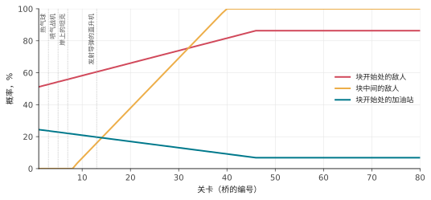

**各关卡新出现的敌人。**

| 从第几关起 | 出现什么 |
|---|---|
| 3 | 热气球 |
| 5 | 喷气战机（在此之前用船代替）；炸毁的桥会让附近的坦克开火 |
| 7 | 河岸公路上的坦克 |
| 13 | 发射导弹的直升机 |

**河弯曲的程度。**河岸游走的范围逐渐变宽：第 1、2 关河几乎是直的（河岸在约 8 个位置内移动）；之后约 15；奇数关从第 10 关起约 39，从第 20 关起几乎遍及整个屏幕。

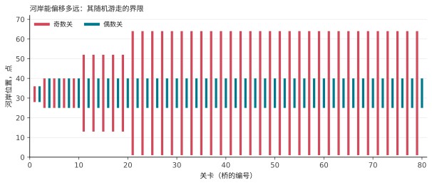

**河岸边的余量。**第 9 关以下，物体离河岸多留几个点，段也从不会很窄；第 20 关以下不使用最窄的段宽。

**移动。**第 2 座桥之前，敌人完全不动。

这也是为什么从第 5、20 或 50 座桥开始的游戏 3–8 要为起点存两样东西：该桥处生成器的状态，它决定河的形状；以及关卡编号，它决定河的难度。没有关卡编号，河的形状一样，但会很简单。

## 你的飞机

- **速度：**向前更快，向后更慢；松开后恢复正常（`changeSpeed`）。
- **转向：**摇杆推向一侧的时间越长，飞机横移越快（`steer`）。
- **燃料：**满箱约可用 34 秒。飞过加油站时，空箱约 2 秒加满；低于四分之一时会响起警告。燃料耗尽即坠毁。
- **射击：**一次一发子弹；它每幅画面向上飞 6 行，直到击中某物或河岸。

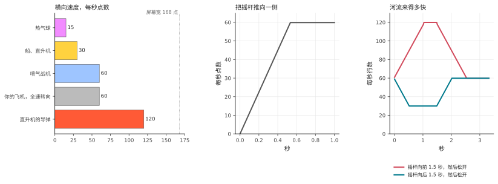

碰到河岸、任何敌人或桥，被坦克炮弹或直升机导弹击中，或者燃料耗尽，你都会损失一架飞机。然后河从上一座桥重新开始（为此生成器记住了每座桥处的状态：`sectionCheckpoint`、`restoreCheckpoint`）；飞机会等到你动摇杆为止。双人游戏中，每损失一架飞机两名玩家就轮换一次。

## 它如何知道什么撞上了什么

河本身只是内存里的一幅图：四种颜色的点。所有在它上面移动的东西，都由视频芯片单独画在图的上面，称为*精灵*（sprite）。Atari 有八个，它的手册称之为 **player** 和 **missile**：

- **player 0、1、2、3**：四个宽 8 点的精灵（芯片也能把它拉宽到 16 或 32 点：船以双倍宽度绘制，桥是四倍）。每个都是一条和屏幕一样高的竖条，有自己的颜色；程序告诉它在横向的位置，以及每一行里它的 8 个点中哪些点亮；
- **missile 0、1、2、3**：另外四个，只有 2 点宽，用来做子弹。

这些名字来自设计芯片时针对的那些游戏：每个玩家的角色是一个“player”，它射出的子弹是“missile”。它们和玩 River Raid 的人毫无关系，编号也只是芯片内部的编号。移动一个精灵只需改变它的位置，下面的河图完全不受影响。River Raid 这样使用它们：

| 精灵 | 显示 |
|---|---|
| player 2 | 你的飞机 |
| missile 2 | 你的子弹 |
| player 1 | 公路上的坦克 |
| player 0 | 它的炮弹 |
| missile 0 | 直升机的导弹 |
| player 3 | **所有**敌人、加油站和桥 |

一个精灵怎么能显示十一个物体？在画面从上到下逐行绘制的过程中，游戏在选定的行上打断自己（*显示列表中断*）。在每条带里，它把 player 3 移到这条带的物体处，设定宽度和颜色，并逐行送入物体的形状。同一个精灵就这样在整个屏幕高度上反复使用（`display`）。

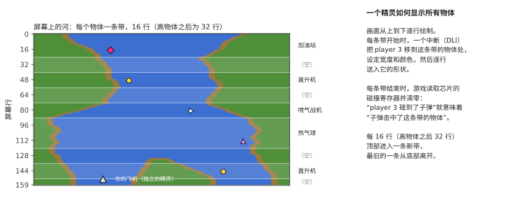

Atari 的视频芯片还会自己记录**碰撞**：每当正在绘制的一行中，某个精灵的点落在另一个精灵的点上或落在河岸颜色上，它就在碰撞寄存器里置一个位。每条带结束后，游戏立刻读取并清零这些寄存器。这样它就确切知道子弹或飞机碰到的是哪条带，也就是哪个物体，而不用自己做任何计算。“飞机撞上河岸”同样只是“player 2 与河岸颜色重叠”。只有绿色算数：4 点宽的棕色岸边对飞机不做检查，所以可以擦着它飞。

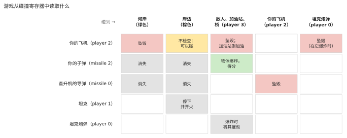

由于这些读取发生在画面绘制过程中，确切的时刻很重要：如果子弹恰好只在读取寄存器的那一行碰到物体，是否算数取决于电子束在那一行上走了多远。移植版通过按每条指令所需的时间、逐条扫描线执行中断代码来重现这一点。

## 没人玩的时候

没有游戏进行时，程序运行**演示模式**：河在没有飞机的情况下流过，敌人移动，状态栏下面的滚动字幕显示制作人员和“Press START”。按一下键盘上的键会暂停游戏，再按一下继续。在很长时间没有任何输入后（约 73 分钟），游戏会静止不动，直到有人按键。

## 声音

Atari 的声音芯片有四个声道；游戏每秒设置它们 60 次（`soundDriver`）：

1. 引擎，音高随速度变化，推或拉摇杆时音色改变；燃料不足警告、加油声或坠毁声会替换它；
2. 爆炸（噪声）和直升机的导弹；
3. 你的射击，以及奖励飞机的号声；
4. 坦克炮弹落下时的呼啸声和爆炸声。
